# Імітаційна модель фонових злиттів MergeTree

Дискретно-подієва модель підсистеми фонових злиттів ClickHouse. Модель описує цю підсистему як систему масового обслуговування, черга якої гальмує власний вхідний потік. Модель відкалібровано і перевірено на живому сервері ClickHouse. Поверх неї зроблено інтерактивну лабораторію, яка працює просто в браузері.

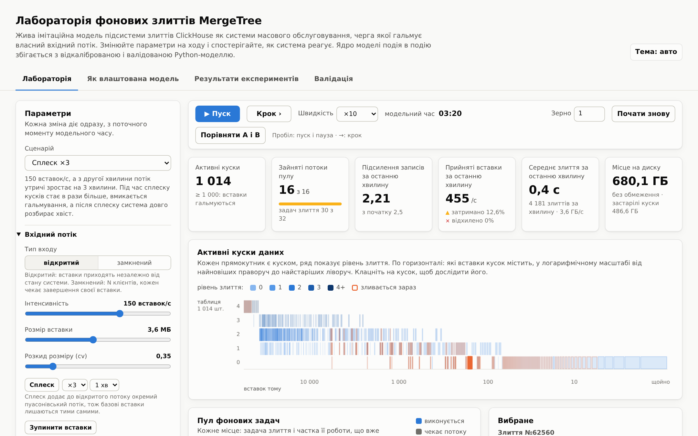

- [Звіт](docs/report.md) ([PDF](docs/report.pdf)): постановка, модель, калібрування, валідація, експерименти E1–E11, висновки.
- [RFC.md](RFC.md): повна специфікація моделі з посиланнями на код ClickHouse. Будь-яка зміна моделі спершу вноситься сюди.
- [app/README.md](app/README.md): будова лабораторії і її тести.

## Що моделюється

Кожен `INSERT` у таблицю `MergeTree` створює на диску новий кусок даних. Фонові задачі зливають сусідні куски в більші, щоб їх не ставало забагато. Якщо злиття не встигають, сервер гальмує вставки: від 1000 кусків у партиції кожна вставка чекає до 1 с, а від 3000 відхиляється з помилкою `TOO_MANY_PARTS`. Отже, черга кусків керує власним входом.

| У ClickHouse | У моделі |
|---|---|
| `INSERT` | заявка: відкритий пуасонівський потік (з добовим профілем і сплесками) або N замкнених клієнтів |
| кусок даних і партиція | елемент черги з рівнем злиття, розміром і віком |
| `SimpleMergeSelector` | правило, яке обирає діапазон сусідніх кусків для злиття |
| пул фонових задач (`background_pool_size`) | багатоканальний пристрій обслуговування, потоки діляться між задачами |
| `delayInsertOrThrowIfNeeded` | зворотний зв'язок: затримка або відхилення вставки |
| `DROP PARTITION`, місце на диску | ротація партицій і обмеження диска |

Правила взято з коду ClickHouse, а не придумано: селектор, межа розміру злиття, планувальник пулу, сон призначувача злиттів, формула затримки, скасування злиттів при видаленні партиції. Числові параметри (вартість злиття, стиснення великих злиттів) виміряно на сервері.

## Як влаштований код

### Схема коду

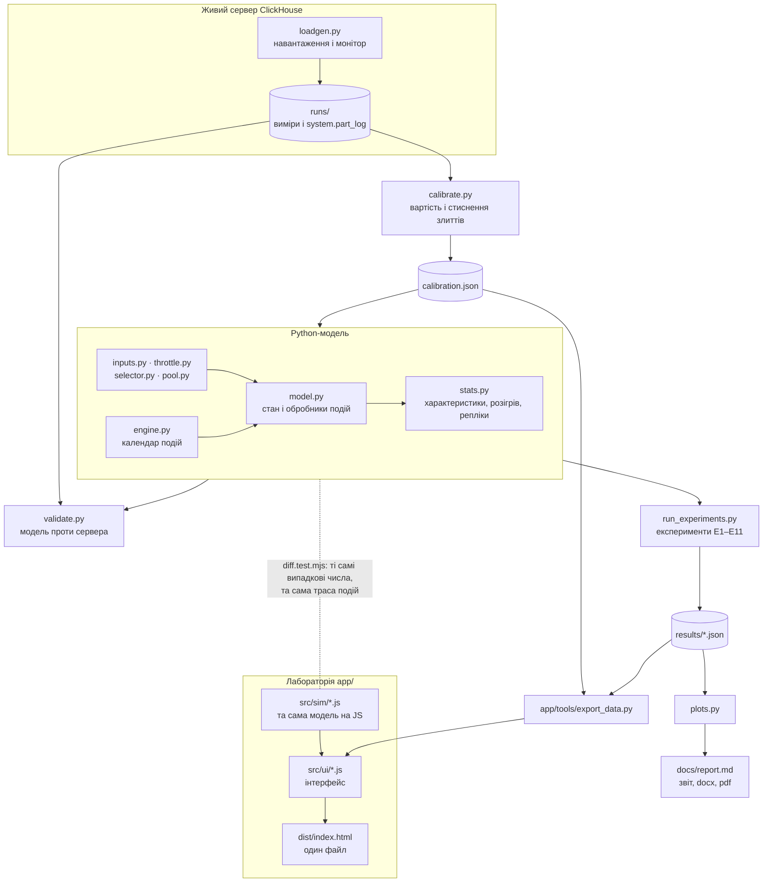

Шлях даних іде згори вниз:

1. `loadgen.py` дає навантаження на окремий сервер ClickHouse і щосекунди знімає кількість кусків і лічильники гальмування. Злиття беруться з `system.part_log`. Усе це зберігається в `runs/`.
2. `calibrate.py` підбирає з цих вимірів вартість злиття і правило стиснення великих злиттів і пише `calibration.json`.
3. Python-модель бере ці параметри. `validate.py` проганяє її на тих самих навантаженнях, що й сервер, і порівнює характеристики.
4. `run_experiments.py` виконує експерименти E1–E11 і пише `results/*.json`. `plots.py` малює з них графіки для звіту.
5. Лабораторія отримує калібрування і результати через `app/tools/export_data.py`. Її ядро `app/src/sim/` повторює Python-модель на JavaScript. Тест `diff.test.mjs` подає йому ті самі випадкові числа і вимагає ту саму трасу подій, подія в подію. Тому лабораторія показує ту саму модель, яку калібровано і валідовано.

### Модель: події

Модель подієва: стан змінюється тільки в моменти подій з календаря `engine.py`. Ось як вони пов'язані:

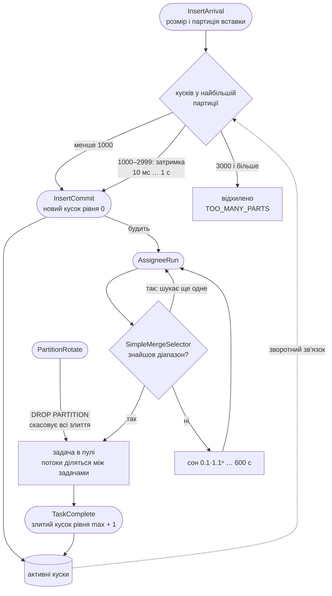

| Подія | Що відбувається |
|---|---|
| `InsertArrival` | розігруються розмір вставки і її партиція, перевіряються пороги гальмування: вставку приймають, затримують або відхиляють |
| `InsertCommit` | з'являється новий кусок рівня 0, і він будить призначувача злиттів |
| `AssigneeRun` | селектор шукає діапазон кусків. Якщо знайшов, задача йде в пул, і призначувач одразу шукає ще одне злиття. Якщо ні, він засинає на час, що росте з кожною невдачею |
| `TaskComplete` | злитий кусок замінює джерела, пул перерозподіляє потоки між задачами |
| `PartitionRotate` | починається нова партиція, найстаріша видаляється разом з усіма злиттями в пулі |

### Модулі

| Файл | Роль |
|---|---|
| `engine.py` | календар подій: купа за часом і порядковим номером |
| `inputs.py` | вхідні потоки і розміри. Кожне джерело випадковості має свій генератор, тож дві конфігурації можна порівнювати на спільних випадкових числах |
| `throttle.py` | `delayInsertOrThrowIfNeeded`: затримка або відхилення вставки |
| `selector.py` | `SimpleMergeSelector` (звичайний і векторизований), базовий tiered-селектор, межа розміру злиття |
| `pool.py` | пул фонових задач: швидкість кожної задачі за `round_robin` або `shortest_task_first` |
| `model.py` | стан таблиці, обробники подій, конфігурація, інваріанти |
| `stats.py` | ймовірнісно-часові характеристики з записаних фактів, розігрів за методом Велча, паралельні репліки, довірчі інтервали |
| `experiments.py`, `run_experiments.py` | плани експериментів E1–E11, зокрема факторний план 2⁵ |
| `open_questions.py` | перевірка гіпотез про розбіжності валідації |
| `test_*.py` | тести моделі: граничні випадки з точною відповіддю, інваріанти, закон Літтла, відповідність коду ClickHouse |

## Як запустити

Інструкцію перевірено на чистій Ubuntu 24.04. На macOS кроки ті самі, змінюється лише встановлення системних пакетів. На Windows найпростіше працювати у WSL.

**1. Системні пакети.** Потрібні Python 3.10+, git, pandoc (для звіту) і Node.js 22 (для тестів лабораторії):

    sudo apt-get update
    sudo apt-get install -y git python3 python3-venv pandoc curl
    curl -fsSL https://deb.nodesource.com/setup_22.x | sudo bash - && sudo apt-get install -y nodejs

**2. Код і Python-пакети.** Пакети ставляться у віртуальне середовище, бо Ubuntu 24.04 не дає ставити їх у системний Python:

    git clone https://github.com/yariks5s/information_system_simulation.git
    cd information_system_simulation
    python3 -m venv .venv && . .venv/bin/activate
    pip install -r requirements.txt

У кожному новому терміналі середовище треба знову активувати: `. .venv/bin/activate`.

**3. Тести моделі.** Близько 5 хвилин, або 2 хвилини паралельно з `-n auto`:

    python3 -m pytest -q -n auto test_*.py

**4. Експерименти.** Швидкий режим пише в `results_quick/` і не чіпає збережених результатів:

    python3 run_experiments.py --quick e1_load   # один експеримент, близько хвилини
    python3 plots.py --quick                     # графіки в results_quick/
    python3 run_experiments.py                   # усі E1–E11: кілька годин на 32 ядрах, пише в results/
    python3 plots.py                             # графіки в results/
    python3 calibrate.py --refit                 # перерахувати calibration.json зі збережених злиттів
    python3 validate.py compare open             # модельна частина валідації (також closed, throttled)

`calibrate.py --refit`, `plots.py` і `docs/build.sh` перезаписують файли в репозиторії. З іншими версіями numpy, scipy чи matplotlib останні знаки чисел і дрібниці графіків можуть відрізнятися, тож `git status` покаже зміни. Повернути збережені файли можна командою `git checkout calibration.json results/ docs/`.

**5. Лабораторія.** Відкрити `app/dist/index.html` у браузері. Це один файл, інтернет не потрібен. Тести лабораторії:

    python3 app/tools/record_python.py           # один раз: записати прогони Python-моделі (120 МБ, не в git)
    cd app && node --test tests/*.test.mjs && cd ..

**6. Перевірка сторінки в браузері і PDF звіту.** Потрібен Chromium для `playwright`:

    playwright install --with-deps chromium      # системні бібліотеки ставить через sudo; або свій Chromium у змінній CHROMIUM
    cd app && python3 tests/browser_check.py light && cd ..
    cd docs && ./build.sh && cd ..               # report.docx, report.pdf і plan.docx з Markdown

Калібрування і валідація потребують окремого сервера ClickHouse. Треба скопіювати Release-бінарник у `server/clickhouse` і запустити `server/clickhouse server --config-file=server/config.xml --daemon` (порти 19480 і 19481). Шляхи в `server/config.xml` абсолютні й розраховані на `/home/ubuntu/merge-sim`, тож для іншого каталогу їх треба змінити.

## Лабораторія

Лабораторія запускає модель просто в браузері. Модель можна пускати, зупиняти, проходити по кроках, змінювати будь-який параметр на ходу і бачити, як реагує система. Сторінка має чотири вкладки: «Лабораторія», «Як влаштована модель», «Результати експериментів» і «Валідація».

### Керування

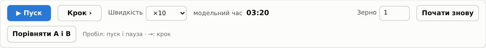

«Пуск» запускає модельний час, «Крок» переводить його до наступної події, яка щось змінює. Швидкість задається від ×0.25 до ×1000 модельних секунд за секунду. Якщо браузер не встигає, поруч видно фактичну швидкість. «Зерно» задає випадкові числа, тож з тим самим зерном прогін повторюється точно. «Почати знову» запускає модель з нуля з поточними параметрами. Пробіл запускає і зупиняє модель, стрілка вправо робить крок.

### Параметри і сценарії

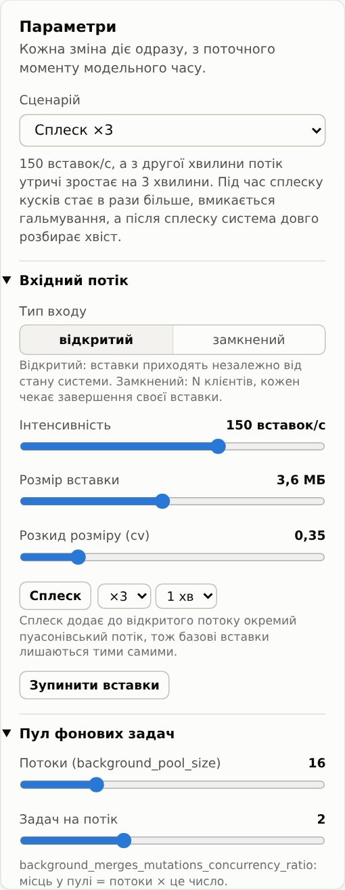

Ліворуч панель параметрів. Кожна зміна діє одразу, з поточного моменту модельного часу, без перезапуску.

Список «Сценарій» вмикає готові конфігурації, і під ним написано, що в кожній варто помітити:

- **Звичайна робота:** 100 вставок/с, злиття встигають.
- **Насичений пул:** усі 16 потоків зайняті, і система міняє кількість кусків на менше підсилення записів.
- **Сплеск ×3:** потік утричі зростає на 3 хвилини, вмикається гальмування, потім система довго розбирає хвіст.
- **Гальмування як зворотний зв'язок:** замкнені клієнти самі сповільнюються біля порогу.
- **Дрібні вставки, малий пул:** той самий потік даних дрібними пакетами насичує пул.
- **Ротація партицій:** нова партиція кожні 2 хвилини, старі видаляються.
- **Деградація tiered-селектора:** куски різних рівнів блокують одне одного.
- **Проєкція:** кожне злиття вдвічі довше.
- **Диск заповнюється:** застарілі куски займають місце, великі злиття перестають стартувати.
- **Без злиттів:** вставки спершу гальмуються, а потім відхиляються.

Групи параметрів відповідають частинам моделі: вхідний потік (відкритий або замкнений, інтенсивність, розмір вставки, сплеск, зупинка вставок), пул (потоки, задач на потік, планувальник), селектор (`SimpleMergeSelector` або tiered, `merge_selector_base`, межі розміру), гальмування (пороги, затримка, обмеження за середнім розміром куска), партиції (ротація, утримання, запізнілі вставки, видалення найстарішої), диск (місце, `old_parts_lifetime`), вартість злиття, проєкція та індекс. Підказка під кожним полем пояснює, що воно змінює.

 

### Показники

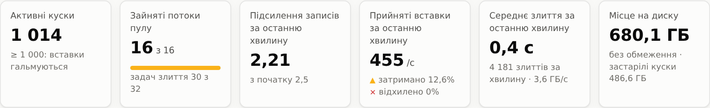

Плитки показують поточний стан: активні куски (і чи вмикається гальмування), зайняті потоки пулу і кількість задач у ньому, підсилення записів і прийняті вставки за останню хвилину (з частками затриманих і відхилених), середню тривалість злиття і місце на диску разом із застарілими кусками.

### Дерево кусків

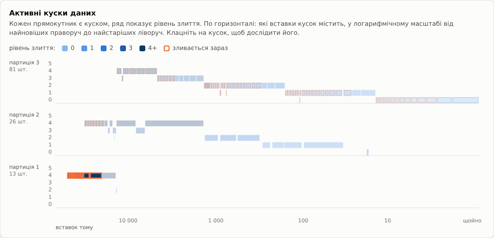

Кожен прямокутник є куском даних, ряд показує його рівень злиття, а колір теж кодує рівень. По горизонталі куски стоять за тим, скільки вставок тому почались їхні дані, у логарифмічному масштабі: найновіші праворуч. Помаранчеві рамки позначають куски, які зараз зливаються. З ротацією партицій кожна партиція має свою смугу, а видно до кількох найновіших. На знімку вибрано задачу злиття в партиції 1, тож її джерела виділені, а решту кусків приглушено.

### Пул фонових задач

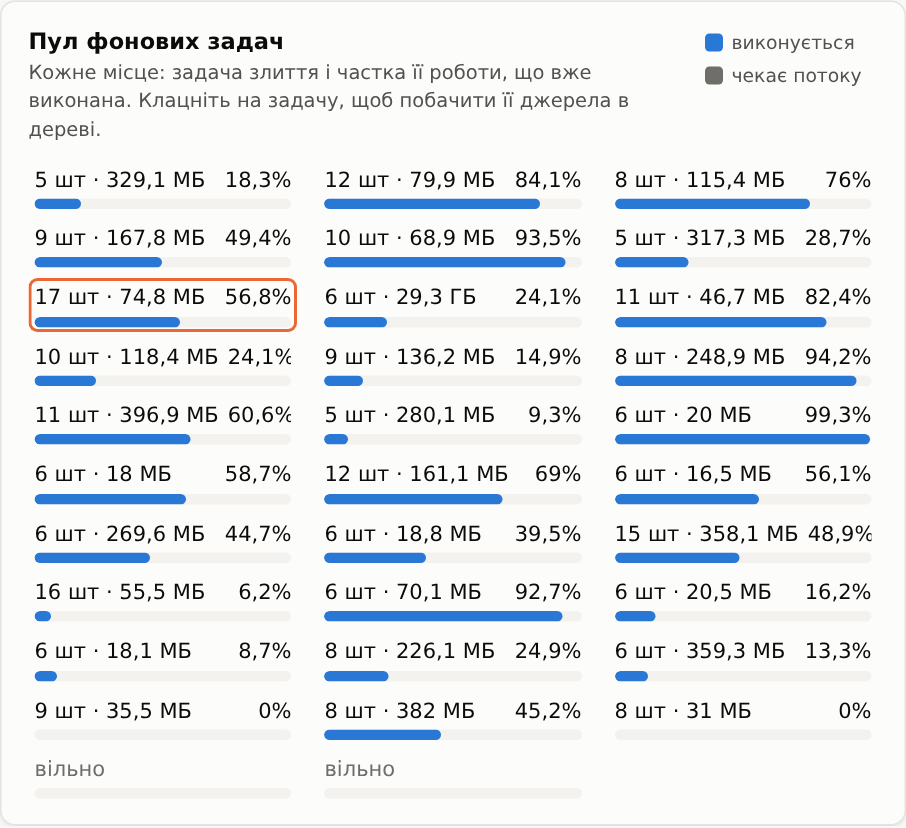

Кожне місце в пулі є задачею злиття: скільки кусків вона зливає, їхній обсяг і яку частку роботи вже виконано. Потоки пулу діляться між задачами за обраним планувальником: `round_robin` ділить порівну, `shortest_task_first` віддає потоки найменшим злиттям. Клік на задачу виділяє її джерела в дереві.

### Вибране і рішення селектора

| Вибрана задача злиття | Чому селектор обрав саме цей діапазон |
|---|---|
| 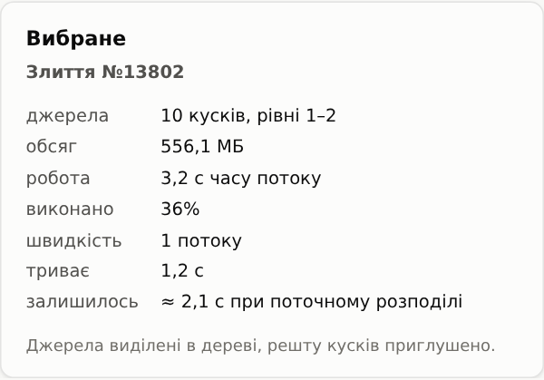 | 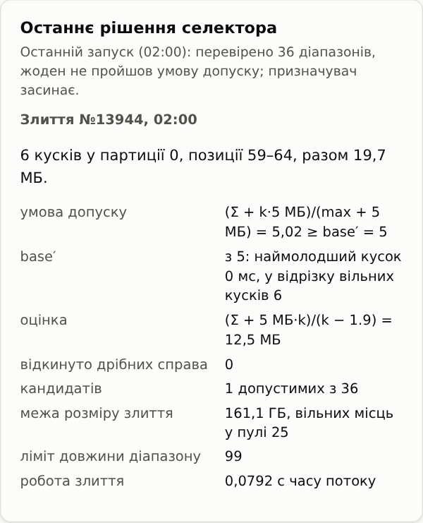 |

Панель «Вибране» показує вибраний кусок або задачу: джерела, обсяг, роботу в секундах потоку, виконану частку, поточну швидкість і скільки лишилось за поточного розподілу потоків. Для куска видно розмір, вік і з якого злиття він з'явився.

Панель «Останнє рішення селектора» пояснює `SimpleMergeSelector`. Верхній рядок описує останній запуск призначувача: що він перевірив і чому заснув. Нижче розібрано останнє призначене злиття:

- умова допуску: діапазон допустимий, якщо (Σ + k·5 МБ)/(max + 5 МБ) ≥ base′;
- знижений base′: він падає від `merge_selector_base` до 2 з віком наймолодшого куска і довжиною відрізка вільних кусків;
- оцінка, за якою обирається найкращий з допустимих діапазонів;
- кількість кандидатів, межа розміру злиття і робота злиття.

### Графіки і журнал

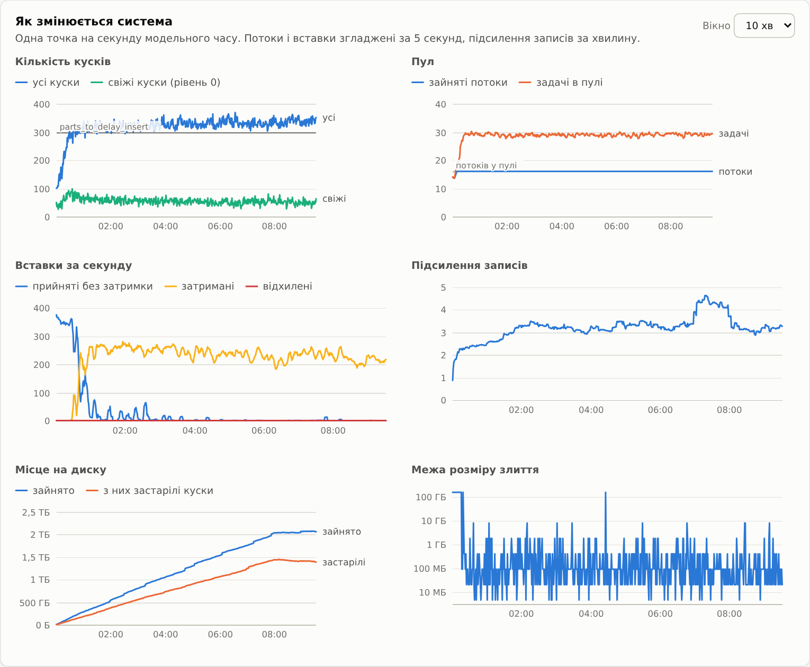

Шість графіків показують останні хвилини модельного часу: кількість кусків (усіх і свіжих), пул (зайняті потоки і задачі), вставки за секунду (прийняті, затримані, відхилені), підсилення записів, місце на диску і межу розміру злиття. На знімку сценарій гальмування: кількість кусків тримається біля порогу 300, а майже всі вставки затримуються. Наведіть курсор на графік, щоб побачити значення в конкретний момент. Вікно графіків можна змінити праворуч угорі.

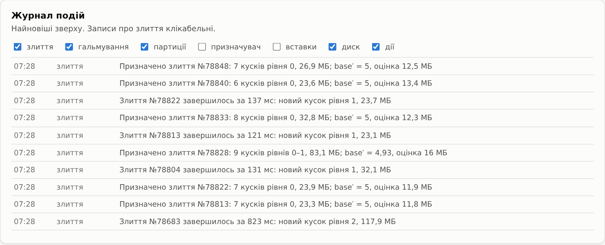

Журнал описує події людською мовою, найновіші зверху: призначені й завершені злиття, гальмування, ротацію і видалення партицій, сон призначувача, вставки, події диска і дії користувача. Типи подій вмикаються прапорцями, а записи про злиття клікабельні.

### Порівняння A і B

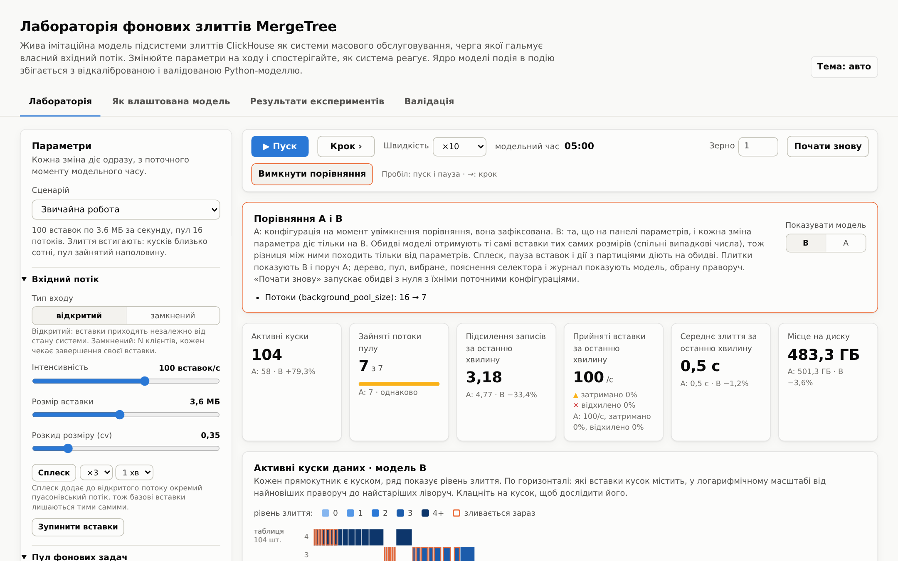

Кнопка «Порівняти A і B» запускає поруч дві моделі з тими самими вставками тих самих розмірів (спільні випадкові числа). A фіксується з поточною конфігурацією, а зміни на панелі параметрів діють тільки на B. Тому різниця між ними походить тільки від параметрів. Плитки показують B і поруч A з відносною різницею, графіки показують обидві моделі. Дерево, пул і журнал перемикаються між A і B. На знімку в B лише 7 потоків замість 16: кусків стає на 79% більше, а підсилення записів на 33% менше, бо злиття стають ширшими.

### Інші вкладки

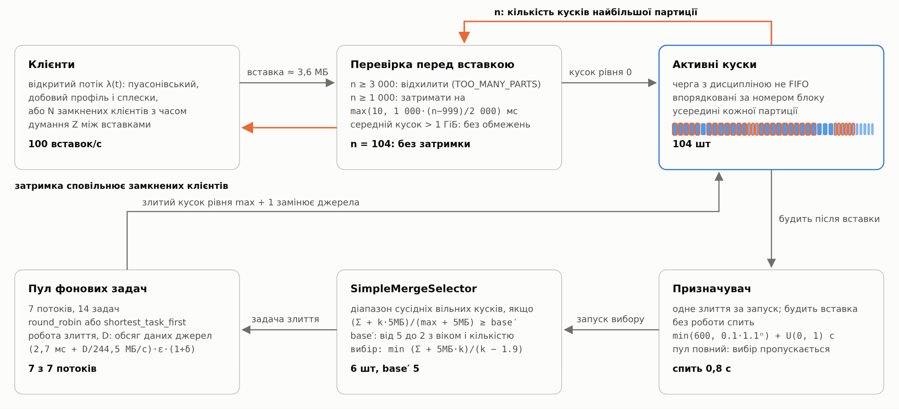

«Як влаштована модель» показує схему моделі з формулами. Жирні значення внизу блоків беруться з моделі, яка зараз працює в лабораторії. Помаранчеві стрілки показують зворотний зв'язок.

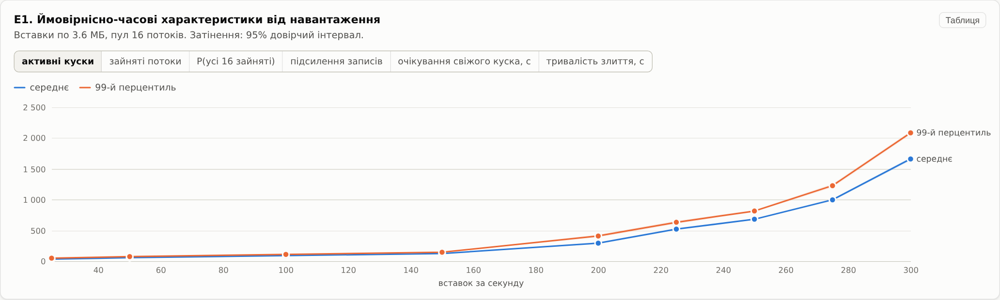

«Результати експериментів» містить графіки E1–E11 з 95% довірчими інтервалами. Кожен графік можна переглянути таблицею.

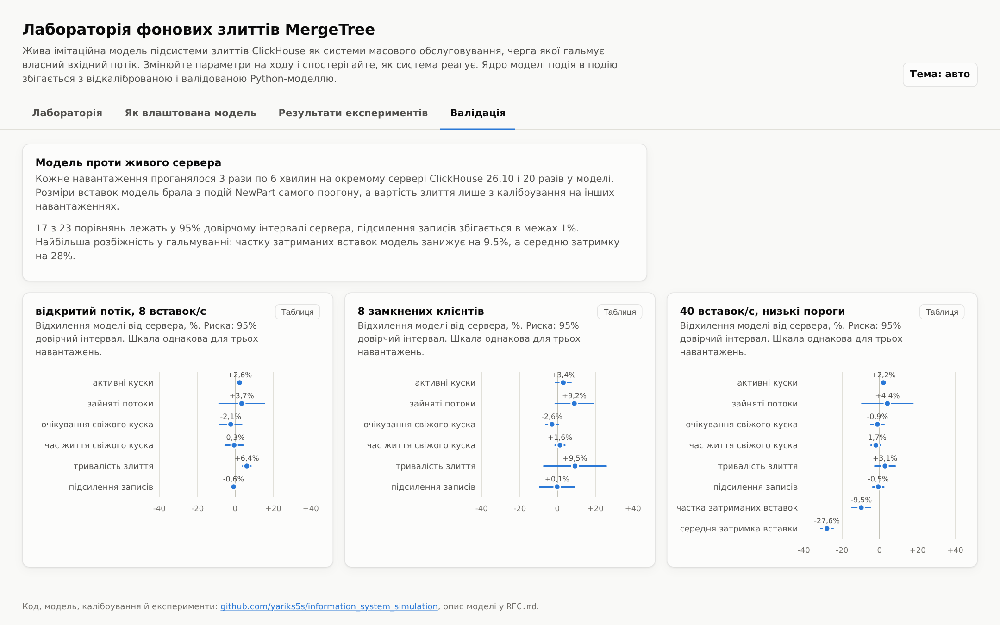

«Валідація» показує, на скільки відсотків модель відхиляється від сервера на трьох навантаженнях, з довірчими інтервалами.

## Головні результати

- На трьох незалежних навантаженнях модель потрапляє в 95% інтервал сервера для 17 з 23 порівнянь, підсилення записів збігається в межах 1%. Частку затриманих вставок біля порогу модель занижує на 9.5%.
- Для вставок по 3.6 МБ і пулу з 16 потоків пул насичується між 150 і 200 вставками за секунду.
- Гальмування стабілізує систему тільки для клієнтів, які чекають своєї вставки. Обмеження за середнім розміром куска, увімкнене за замовчуванням, вимикає цей захист у великій партиції вже за 20–25 хвилин.
- Кожен `DROP PARTITION` скасовує всі злиття таблиці, а не лише злиття своєї партиції.
- Біля насичення `shortest_task_first` дає на 21–30% менше кусків, ніж `round_robin`.

Подробиці й інші висновки є у [звіті](docs/report.md).

## Структура репозиторію

| Шлях | Що це |
|---|---|
| `engine.py`, `inputs.py`, `pool.py`, `selector.py`, `throttle.py`, `model.py` | модель на Python |
| `stats.py` | ймовірнісно-часові характеристики, розігрів, репліки, довірчі інтервали |
| `loadgen.py`, `calibrate.py`, `validate.py` | навантаження на живий сервер, калібрування, валідація |
| `experiments.py`, `run_experiments.py`, `plots.py` | експерименти E1–E11 і графіки |
| `calibration.json`, `results/`, `runs/` | відкалібровані параметри, результати експериментів, виміри на сервері |
| `test_*.py` | тести Python-моделі |
| `open_questions.py` | перевірка гіпотез про розбіжності валідації |
| `app/` | лабораторія в браузері, [app/README.md](app/README.md) |
| `docs/` | план і звіт (`.md`, `.docx`, `.pdf`), `build.sh` для їх збирання, знімки в `docs/img/` |
| `server/` | конфігурація окремого сервера ClickHouse для калібрування і валідації |
