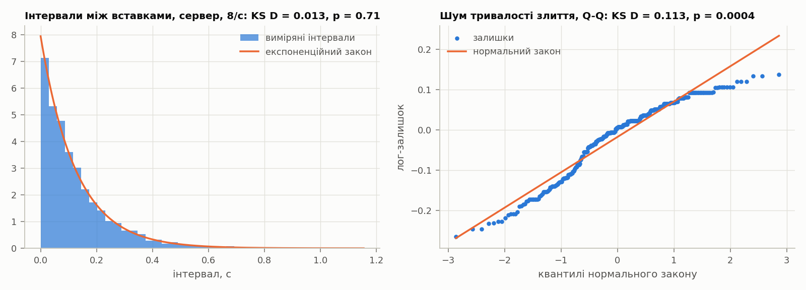
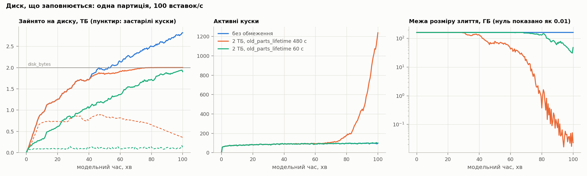
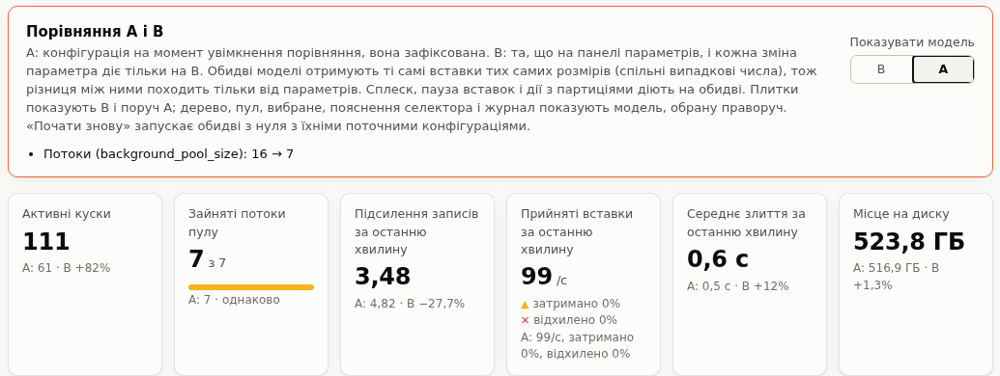

# Вступ

ClickHouse зберігає таблиці типу `MergeTree` у вигляді незмінних кусків даних (parts). Кожна вставка записує на диск новий кусок, а фонові потоки постійно зливають дрібні куски у більші. Це класична ідея LSM-дерева [8]: писати швидко і впорядковано, а впорядкування доробляти у фоні. Ціна цієї ідеї в тому, що злиття конкурують між собою за обмежений пул потоків, а кожен байт за життя таблиці переписується кілька разів.

Якщо злиття не встигають за вставками, кусків стає дедалі більше. Щоб це не тривало безкінечно, сервер має захист: коли в партиції набирається 1000 кусків, кожна нова вставка штучно затримується, а на 3000 кусках вставки відхиляються з помилкою `TOO_MANY_PARTS`. Тобто черга кусків сама гальмує свій вхідний потік. Саме ця властивість робить систему цікавою для моделювання: вона має область нестійкості, межу якої ніде не задано явно, а поведінка біля цієї межі залежить від багатьох налаштувань одночасно.

Аналітично таку систему не розв'язати. Обслуговування тут іде партіями змінного розміру, дисципліна вибору партії залежить від стану черги і навіть від завантаження приладів, а вхідний потік залежить від довжини черги. Тому в роботі побудовано дискретно-подієву імітаційну модель [1, 2], яка відтворює реальні правила ClickHouse; її відкалібровано й валідовано на живому сервері, а потім використано для серії експериментів. Окремо зроблено інтерактивну лабораторію: ту саму модель у браузері, якою можна керувати наживо.

Мета роботи: знайти межу стійкості підсистеми злиттів і пояснити, як від навантаження, розміру вставок, розміру пулу, налаштувань селектора, допоміжних структур і партиціювання залежать ймовірнісно-часові характеристики системи.

# Об'єкт моделювання

Кусок даних у `MergeTree` містить діапазон номерів блоків: кожна вставка отримує наступний номер, а злитий кусок покриває діапазон своїх джерел. Зливати дозволено лише сусідні куски однієї партиції, тому куски утворюють впорядкований ряд, а результат злиття займає місце своїх джерел. Рівень куска показує, скільки разів його дані вже переписувались: свіжа вставка має рівень 0, а злиття дає рівень, на одиницю більший за найвищий рівень джерел.

Яке злиття призначити, вирішує `SimpleMergeSelector`. Він перебирає діапазони сусідніх вільних кусків і допускає лише ті, де сума розмірів достатньо велика порівняно з найбільшим куском діапазону. Поріг цього порівняння, `merge_selector_base`, за замовчуванням дорівнює 5: якщо всі куски однакові, зливати можна щонайменше п'ять. Поріг знижується до 2 для старих кусків і для довгих рядів кусків, щоб система не накопичувала їх. Серед допустимих діапазонів обирається той, що найбільше зменшує середню кількість кусків на одиницю роботи. Розмір злиття обмежено 150 ГіБ, але коли пул майже заповнений, межа експоненційно падає до 1 МіБ, щоб великі злиття не займали останні місця.

Злиття виконує фоновий пул: 16 потоків і 32 місця для задач. Задача виконується покроково, і після кожного кроку потік переходить до наступної задачі, тож задачі ділять потоки між собою. Призначувач злиттів запускається після кожної вставки і за один запуск обирає не більше одного злиття. Якщо обирати нема чого, він засинає з експоненційною затримкою, від десятої частки секунди до десяти хвилин; кожне завершене злиття теж трохи подовжує наступний сон.

Гальмування вставок лінійне: за n ≥ 1000 кусків у партиції вставка затримується на max(10, ⌊1000 · (n − 999) / 2000⌋) мс, але не більше ніж на 1 с. Цікава деталь: якщо середній кусок у партиції більший за 1 ГіБ, гальмування і відхилення вимикаються повністю. Опис налаштування `max_delay_to_insert` наводить і стару степеневу формулу, і лінійну, чинну з версії 23.1; модель відтворює лінійну.

Злиття обмежує й місце на диску. Злиття стартує, лише якщо вільного незарезервованого місця вдвічі більше за суму його джерел, і на час роботи резервує 1.1 цієї суми, а в міру запису нового куска резерв зменшується. Джерела завершеного злиття ще 8 хвилин лежать на диску (`old_parts_lifetime`), поки їх не видалить фонове очищення. Вставка, якій бракує місця під новий кусок, відхиляється з помилкою `NOT_ENOUGH_SPACE`.

Коли партицію видаляють командою `DROP PARTITION`, сервер спершу скасовує всі злиття таблиці, а не лише цієї партиції, і їхня робота втрачається. Куски видаленої партиції теж ще 8 хвилин лежать на диску.

Злиття не просто складає байти джерел. За журналом сервера злитий кусок займає 0.992 суми джерел, але злиття від приблизно 100 МіБ стискають байти, що ще не проходили таке злиття, до 0.795, і такі злиття на 14% повільніші. Механізму цього в коді не знайдено, тож модель відтворює його як емпіричне правило (розділ «Вхідні дані й калібрування»).

Кожен з цих механізмів перенесено в модель з вихідного коду ClickHouse 26.10 (`SimpleMergeSelector.cpp`, `CompactionStatistics.cpp`, `MergeTask.cpp`, `MergeTreeBackgroundExecutor.h`, `BackgroundJobsAssignee.cpp`, `MergeTreeData::delayInsertOrThrowIfNeeded`) і звірено з ним за логікою, а не лише за назвами.

# Концептуальна модель

У термінах теорії масового обслуговування заявки тут є кусками даних. Вони надходять із вставками і чекають у черзі, якою є впорядкований ряд активних кусків партиції. Приладами є потоки фонового пулу. Обслуговування відбувається партіями: селектор забирає з черги кілька сусідніх кусків, а результат обслуговування повертається в ту саму чергу як новий кусок вищого рівня. Дисципліна обслуговування не FIFO і залежить від стану: від розмірів і віку кусків, від довжини ряду, від того, скільки місць у пулі вільно. Вхідний потік залежить від довжини черги через гальмування і відхилення.

Стан моделі складається з рядів активних кусків кожної партиції (розмір, рівень, діапазон блоків, час створення, ознака «зливається»), задач у пулі з залишком роботи, застарілих кусків, що ще лежать на диску, стану призначувача і лічильників. Події такі:

| Подія | Що відбувається | Що планує |
|---|---|---|
| надходження вставки | перевірка порогів: відхилити, затримати або прийняти | фіксацію вставки, наступне надходження |
| фіксація вставки | перевірка місця на диску; новий кусок рівня 0 або відхилення з `NOT_ENOUGH_SPACE` | запуск призначувача |
| запуск призначувача | вибір одного злиття, задача в пул | наступний запуск одразу або після сну |
| завершення задачі | заміна джерел злитим куском, джерела стають застарілими, перерозподіл потоків | наступне завершення |
| ротація партиції | нова партиція, видалення найстаріших | наступну ротацію |

Вхідний потік є нестаціонарним пуасонівським: інтенсивність може мати добовий профіль, а генерується він методом проріджування [7]. Сплеск додається як другий, окремий пуасонівський потік, тож вставки основного потоку з ним і без нього однакові. Крім відкритого потоку модель має замкнений: N клієнтів, кожен з яких після завершення своєї вставки думає випадковий час і вставляє знову. У замкненому варіанті затримка вставки прямо зменшує вхідний потік, і саме в ньому гальмування працює як справжній зворотний зв'язок.

Розмір вставки логнормальний із заданим середнім і коефіцієнтом варіації. Робота злиття дорівнює `(c0 + c1 · D) · (1 + δ) · ε`, де D обсяг даних джерел без надбавки структур до розміру (байти, що вже пройшли велике злиття, рахуються з множником 1/0.795), ε логнормальний шум із середнім 1, а δ надбавка за проєкції та індекси; злиття від 100 МіБ ще множаться на 1.14. Пул розподіляє потоки між задачами: у режимі `round_robin` кожна з n задач отримує частку min(1, 16/n) потоку, у режимі `shortest_task_first` потоки дістаються найменшим злиттям. Окремих кроків по 50 мс модель не відтворює: вони на порядки коротші за типове злиття, тож розподіл процесора є їхньою границею.

Ймовірнісно-часові характеристики, які рахує модель:

- кількість активних кусків: середнє за часом, розподіл за часом і його квантилі; окремо кількість свіжих кусків, тобто кусків рівня 0, які ще не брали участі в злитті;
- зайнятість пулу: середня кількість зайнятих потоків і ймовірність, що зайняті всі;
- час очікування свіжого куска: від запису до моменту, коли його взяло злиття, і час життя: до моменту, коли злиття завершилось;
- тривалість злиття;
- підсилення записів: скільки байтів прочитали злиття на кожен вставлений байт, тобто скільки разів у середньому переписується кожен байт;
- частки затриманих і відхилених вставок (окремо з `TOO_MANY_PARTS` і `NOT_ENOUGH_SPACE`) і розподіл затримки;
- час відновлення після сплеску.

Генератори випадкових чисел. Кожне джерело випадковості має власний генератор: інтервали і проріджування основного потоку, розміри, рішення про запізнілу вставку, шум тривалості злиття, сон призначувача, ті самі величини для сплеску і час думання кожного замкненого клієнта. У Python це `random.Random` (вихор Мерсенна MT19937), засіяний рядком «зерно:назва джерела», який хешується SHA-512; у лабораторії генератор sfc32, засіяний хешем cyrb128 того самого рядка. Експоненційні величини генеруються оберненням функції розподілу, логнормальні з нормальних за алгоритмом відношення рівномірних (Кіндерман, Монахан), як у стандартній бібліотеці Python [6]. Окремі генератори потрібні для методу спільних випадкових чисел [2]: зміна одного фактора не зсуває випадкові числа інших джерел.

# Вхідні дані й калібрування

Параметри вартості злиття взято не з голови, а з журналу `system.part_log` окремого сервера ClickHouse 26.10, розгорнутого для роботи. На сервер подавались чотири навантаження: три по 10 хвилин (4 вставки за секунду по 25 тисяч рядків) у таблиці без допоміжних структур, з індексом `bloom_filter` і з проєкцією, а також п'ятихвилинне навантаження з дрібними вставками, без якого фіксована вартість злиття не визначається.

Для кожного злиття з журналу брались тривалість і сума розмірів джерел. Коефіцієнти c0 і c1 підбирались нелінійним методом найменших квадратів на логарифмічній шкалі, тобто для медіани, а потім перераховувались так, щоб шум мав середнє 1. Залишки регресії перевірялись на відсутність тренду з розміром і на форму розподілу, окремо для малих і великих злиттів.

Під час ревʼю моделі з'ясувалось, що злиття від порогу близько 100 МіБ поводяться інакше. Їхній результат займає 0.795 джерел, а не 0.992, якщо байти джерел ще не проходили таке злиття; змішані злиття дають 0.87–0.99. Тож кожен байт стискається вдруге лише один раз, і зважене за байтами відношення становить 0.93, тоді як медіана 0.992 це ховала. Ті самі злиття повільніші: на лінії вартості великі злиття зі свіжими байтами мали середній логарифмічний залишок +0.11, змішані +0.30, а малі −0.02. Модель пояснює обидва числа: великі злиття повільніші в 1.14 раза, а байт, що вже пройшов велике злиття, містить у 1.26 раза більше даних. З цим правилом передбачений залишок кожного з 15 змішаних злиттів збігається зі спостереженим з точністю до 0.04.

| Параметр | Значення | Дані |
|---|---|---|
| фіксована вартість злиття c0 | 2.7 мс | 671 злиття від 1.26 МіБ до 2.3 ГіБ |
| швидкість злиття 1/c1 | 244.5 МБ/с на потік | те саме |
| коефіцієнт варіації шуму | 0.12 | те саме |
| залишки | кореляція Спірмена з розміром 0.02, асиметрія −0.13, ексцес −0.13 | логарифмічна шкала |
| розмір злитого куска | 0.992 джерел; від 100.3 МіБ 0.795 для свіжих байтів | 376 злиттів |
| сповільнення великих злиттів | 1.14 | 37 великих і 330 малих злиттів |
| кусок вставки | 3.61 МБ, коефіцієнт варіації 0.35 | 25 тисяч рядків на запит |
| індекс `bloom_filter` (надбавка до розміру s, до часу δ) | 0.007, 0.102 | 376 злиттів |
| проєкція (s, δ) | 0.99, 1.00 | 362 злиття |

Надбавку δ рахує відношення швидкості таблиці зі структурою до швидкості, яку модель бере для основних даних, тож змодельована таблиця з індексом чи проєкцією зливається так само швидко, як виміряна. Розмір вставки описує кусок, а не окремий запит: калібрувальні прогони ще йшли з асинхронними вставками, увімкненими за замовчуванням з версії 26.2, і на один кусок припадало 1.16 запиту. Синхронний запит на 25 тисяч рядків дав би кусок близько 3.1 МБ з майже нульовим розкидом. Для проєкції лінійна модель вартості гірша: залишки ростуть з розміром злиття, тобто великі злиття з проєкцією непропорційно повільніші. Це записано як обмеження моделі.

Перевірено й закони розподілу вхідних величин. Інтервали між вставками у відкритому прогоні з 8 вставками за секунду узгоджуються з експоненційним законом: критерій Колмогорова-Смирнова дає D = 0.013, p = 0.51 (і p = 0.73 та 0.19 у двох інших прогонах), коефіцієнт варіації 1.01. Параметр закону оцінено з тієї самої вибірки, тому p-значення пораховано методом Монте-Карло: для кожної змодельованої вибірки параметр оцінюється заново (критерій Ліллієфорса). Ця перевірка стосується генератора навантаження, а не сервера: файл прогону зберігав заплановані моменти вставок. Пуасонівський потік тут закладено побудовою. Тепер генератор записує фактичні моменти відправлення, і наступні прогони перевірять, що потік не спотворюється на шляху до сервера. Логарифмічні залишки тривалості малих злиттів нормальному закону не відповідають (D = 0.11, p < 0.001). Сходинки на графіку показують причину: журнал зберігає тривалість у цілих мілісекундах, а найкоротші злиття тривають 8–30 мс, до того ж верхній хвіст легший за нормальний. Логнормальний шум тому є наближенням: середнє й розкид він передає, а форму хвоста ні. Цілі мілісекунди також занижують c0 приблизно на 0.5 мс.

Під час валідації з'ясувалось, що з версії 26.2 у ClickHouse за замовчуванням увімкнені асинхронні вставки: сервер буферизує кілька вставок і пише їх одним куском. Модель описує синхронні вставки, тому генератор навантаження у валідаційних прогонах вимикає асинхронний режим явно; калібрувальні прогони йшли ще до цього, і їхні куски вставок є пачками (див. вище).

# Програмна реалізація

Модель написана на Python; з бібліотек ядро використовує лише `numpy` для векторизованого селектора. Рушій тримає календар подій у бінарній купі, впорядкованій за часом і порядковим номером, тож події з однаковим часом виконуються в порядку планування. Кожне джерело випадковості має власний потік випадкових чисел: інтервали між вставками, розміри, шум тривалості злиття, сон призначувача, час думання кожного клієнта. Це потрібно для методу спільних випадкових чисел: якщо змінити, наприклад, швидкість злиття, потік вставок лишиться тим самим, і різниця між конфігураціями не тонутиме в шумі.

Модель не рахує статистику під час прогону, а записує факти: коли кожен кусок створено, коли його взяло злиття і коли він зник, коли кожна задача прийшла в пул і завершилась, яка затримка була у кожної вставки. Усі характеристики потім обчислюються з цих фактів для будь-якого вікна спостереження, без повторного прогону. Репліки виконуються паралельно на окремих процесах.

Селектор є найдорожчою частиною: на кожен виклик він перебирає до тисячі початків діапазону і до сотні довжин. Тому, крім прямого перенесення C++ коду, є векторизована версія на `numpy`, яка обробляє всі діапазони відрізка одночасно. Окремий тест перевіряє, що обидві версії обирають той самий діапазон на 3000 випадкових наборах кусків і дають однакові траєкторії цілих прогонів. Векторизація прискорила прогони біля межі стійкості з 400 до 75 секунд на 30 модельних хвилин.

Обсяг коду: близько 7 300 рядків, з них 2 400 рядків Python у моделі, статистиці, калібруванні й експериментах, 740 рядків тестів Python і близько 4 100 рядків інтерактивної лабораторії разом із її тестами.

# Верифікація

Верифікація відповідає на питання, чи модель робить те, що задумано. Перевірок кілька рівнів.

Інваріанти перевіряються після кожної події, на прогонах до мільйона подій: сума розмірів активних кусків дорівнює сумі прийнятих вставок мінус видалені партиції; куски кожної партиції не перетинаються за діапазонами блоків і покривають усі прийняті блоки; задач у пулі не більше за кількість місць, а зайнятих потоків не більше за кількість потоків; джерела кожного злиття стоять поруч; кожна вставка або прийнята, або чекає затримки, або відхилена гальмуванням чи через брак місця; зайняте місце не перевищує обмеження диска.

Селектор перевірено на випадках з результатом, обчисленим вручну. Наприклад, п'ять свіжих кусків по 10 МіБ при `base = 5` є мінімумом для злиття, а чотири вже ні; старі куски знижують поріг до двох; кусок, що зливається, розриває ряд; дрібний кусок справа відкидається. На одному з таких випадків тест виявив, що ClickHouse обрізає дробову частину ліміту довжини діапазону, і на 60 кусках ліміт дорівнює 99, а не 100.

Граничні тести мають точну відповідь. Без злиттів один клієнт отримує рівно 3000 кусків і рівно 2000 затриманих вставок, а сумарна затримка дорівнює сумі формули гальмування. Для замкненого входу без гальмування пропускна здатність дорівнює N/Z, а з гальмуванням N/(Z + R), де R середня затримка, з похибкою до 5%. Для черги свіжих кусків виконується закон Літтла: середня кількість дорівнює добутку інтенсивності на середній час життя. В усіх прогонах експериментів відносна похибка цієї рівності не більша за 2.6%, найбільша з ротацією партицій. Нестаціонарні прогони визначає не ця рівність, а метод Велча (розділ «План експериментів»).

Ревʼю всіх підсистем, проведене після першої версії звіту, знайшло кілька відмінностей моделі від коду ClickHouse і помилок методики; їх виправлено, і всі експерименти перераховано. Кожне виправлення має свій тест: розмір і вартість великих злиттів, скасування злиттів командою `DROP PARTITION`, сплеск як окремий потік, рішення про запізнілу вставку в момент надходження, вік куска в цілих секундах, порядок округлення затримки, метод Велча без незгладженого кінця кривої. Тест на вік, наприклад, побудовано так, що стара версія селектора його не проходить.

Ще одна перевірка з'явилась разом із лабораторією. Ядро моделі переписано на JavaScript, і JavaScript-версія отримує ті самі випадкові числа, які витягла Python-модель. Обидві мусять дати ту саму трасу подій. Тест перевіряє також, що JavaScript просить кожне випадкове число з тими самими параметрами, що використано всі записані числа і що інваріанти виконуються після кожної події. Траси збігаються повністю на п'ятнадцяти конфігураціях, близько 860 тисяч подій, включно з гальмуванням, відхиленнями замкнених клієнтів, видаленням партицій зі скасуванням злиттів, запізнілими вставками, сплеском, заповненим диском і великими злиттями. Коли до моделі додавався диск, записані раніше траси без обмеження диска показали, що модель без нього не змінилась ні на подію. Перший прогін цього тесту знайшов помилку перенесення в нормуванні порогу селектора, тож тест довів свою користь.

# Валідація

Валідація відповідає на інше питання: чи модель поводиться як справжня система. На тому самому сервері проганялись три навантаження, які не брали участі в калібруванні: відкритий потік 8 вставок за секунду, 8 замкнених клієнтів і відкритий потік 40 вставок за секунду зі зниженими порогами гальмування (15 і 45 кусків), щоб гальмування спрацьовувало часто. Кожне навантаження проганялось тричі по 6 хвилин на сервері і 20 разів у моделі. Розміри вставок модель брала з самого прогону, бо це вхідні дані, а вартість злиття лише з калібрування.

| Характеристика | відкритий, 8/с | 8 клієнтів | 40/с, низькі пороги |
|---|---|---|---|
| середня кількість кусків | +2.6% | +3.4% | +2.2% |
| зайняті потоки | +3.7% | +9.2% | +4.4% |
| очікування свіжого куска | −2.1% | −2.6% | −0.9% |
| час життя свіжого куска | −0.3% | +1.6% | −1.7% |
| тривалість злиття | +6.4% | +9.5% | +3.1% |
| підсилення записів | −0.6% | +0.1% | −0.5% |
| частка затриманих вставок | — | — | −9.5% (19.1% проти 21.1%) |
| середня затримка вставки | — | — | −27.6% (11.3 проти 15.6 мс) |

Критерій валідації заздалегідь був такий: середнє моделі лежить у 95% довірчому інтервалі сервера. Він виконується для 17 з 23 порівнянь. Решта шість такі. Кількість кусків у відкритому і загальмованому навантаженні більша на 2.2–2.6%, а інтервал сервера там лише ±0.5–1.4%, бо прогонів на сервері три. Тривалість злиття у відкритому навантаженні більша на 6.4%, зайнятість пулу з клієнтами на 9.2%. Справжня розбіжність одна: гальмування. Частку затриманих вставок модель занижує на 9.5%, середню затримку на 28%.

Перша версія моделі вважала злитий кусок рівним сумі джерел і завищувала підсилення записів на 6–8%. Розділ про калібрування показав причину: великі злиття стискають дані. З цим правилом підсилення записів збігається з сервером у межах 1%. Першу гіпотезу, затримку між пробудженням призначувача і вибором злиття, перевірено проти збережених прогонів. Вона розбіжність не пояснювала: навіть 10–30 мс помітно псували характеристики, які й так збігались.

Розбіжність у гальмуванні має дві ймовірні причини, і обидві можна перевірити лише новим прогоном на сервері. По-перше, сервер і модель рахують дещо різні події. На сервері запит вважається затриманим, якщо спав хоч один з його паралельних приймачів, а приймач, що стартує пізніше, може побачити вже записаний кусок свого ж запиту. Модель перевіряє кількість кусків один раз, без куска самої вставки. Якщо в моделі рахувати кусок самої вставки, частка затриманих зростає з 19.1% до 28.6%, а сервер з 21.1% лежить між цими межами. По-друге, під час валідаційного прогону сервер конкурував за процесор з іншими процесами машини. Прогін з `max_insert_threads = 1`, тобто з одним приймачем, розділив би ці причини. Тому середні характеристики модель дає надійно, а частку затриманих вставок біля порогу слід читати як нижню оцінку.

Під час валідації знайшлась і особливість самого ClickHouse. Запит `INSERT ... SELECT` будує кілька паралельних приймачів даних: `max_insert_threads = 0` за замовчуванням означає «автоматично», тобто стільки, скільки ядер (на цій машині 32), з обмеженням за вільною пам'яттю. Кожен приймач, навіть той, до якого не дійде жодного рядка, окремо перевіряє кількість кусків і окремо спить. Через це системні лічильники `DelayedInserts` і `DelayedInsertsMilliseconds` рахують не вставки, а приймачі, на сервері до 12 на одну вставку, а реальна додана затримка вставки під навантаженням виявилась утричі більшою за формулу. На чистому сервері цей ефект відтворено: одна вставка одного рядка з `max_insert_threads = 8` дає шість затримок по 500 мс у лічильниках. Для валідації затримку кожної вставки брали з її власного запису в `system.query_log`.

# План експериментів

Усі експерименти беруть відкалібровану модель з налаштуваннями ClickHouse за замовчуванням і змінюють лише вказані фактори. Якщо не сказано інше, куски вставок мають 3.6 МБ, пул 16 потоків, вхід відкритий, 10 незалежних реплік по одній модельній годині, довірчі інтервали 95% за розподілом Стьюдента [2]. Десяти реплік достатньо: півширина інтервалу для середньої кількості кусків у більшості конфігурацій менша за 2% середнього.

Важливе спостереження щодо стаціонарності: загальна кількість кусків однієї партиції, що росте, не має стаціонарного режиму. Рівнів злиття стає більше з логарифмом розміру таблиці, а куски, що досягли межі 150 ГБ, більше не зливаються і накопичуються. Тому кінець розігріву оцінювався методом Велча [2] для кожної конфігурації, не по загальній кількості кусків, а по кількості свіжих кусків рівня 0. Криву реплік згладжує ковзне середнє, обчислене лише там, де вікно повне з обох боків. Розігрів закінчується, коли згладжена крива назавжди входить у смугу навколо середнього другої половини прогону шириною 5%, але не вужчу за три стандартні похибки згладженої точки, бо інакше шум кривої приймався б за тренд. Рядки однієї таблиці порівнюються між собою, тому мають спільне вікно: статистика рахується після найкоротшого з розігрівів 10, 20, 30 або 40 хвилин, що покриває оцінки всіх конфігурацій експерименту. Якщо свіжі куски якоїсь конфігурації не виходять на рівень до 40-ї хвилини, вона на вибір розігріву не впливає і позначена як нестаціонарна: її характеристики залежать від горизонту спостереження. Ротація партицій (експеримент E10) робить стаціонарною і загальну кількість.

Межа стійкості шукалась бісекцією в логарифмічному масштабі: найбільша інтенсивність, за якої жодна з шести реплік не дала жодної затриманої вставки за 30 модельних хвилин. Обмеження за середнім розміром куска тут вимкнене, бо інакше велика партиція перестає гальмуватись, і критерій вимірював би момент спрацювання цього обмеження, а не стійкість; отже, критерій означає «жодна партиція не дійшла до 1000 кусків». Прогін зупиняється на першій затриманій вставці, тож нестійкі точки дешеві, а всі дев'ять кривих просуваються разом, щоб один пул процесів обслуговував їх усі. Межа залежить від горизонту спостереження, бо біля неї кусків стає більше повільно, тому в результатах вона названа межею на горизонті 30 хвилин.

| № | Питання | Фактори |
|---|---|---|
| E1 | як характеристики залежать від навантаження | 25–300 вставок/с, 9 рівнів |
| E2 | що дає розмір пакета за однакового потоку даних | 180 МБ/с; вставки 0.29–14.4 МБ; пул 4 і 16 |
| E3 | де межа стійкості | розмір вставки × (пул 16, пул 4, пул 16 з проєкцією) |
| E4 | компроміс підсилення записів і кількості кусків | `SimpleMergeSelector` з base 2–20 проти tiered з base 2–12 |
| E5 | чи кращий `shortest_task_first` біля насичення | обидві політики при 200 і 250 вставках/с |
| E6 | як працює зворотний зв'язок | відкритий і замкнений вхід × обмеження за розміром куска |
| E7 | скільки триває відновлення після сплеску | сплеск ×1.5, ×2, ×3 на 5 хвилин, парне порівняння з прогоном без сплеску |
| E8 | вартість допоміжних структур | без структур, індекс, проєкція, обидва |
| E9 | які фактори найвпливовіші | факторний план 2⁵, 6 реплік по 60 хвилин, ефекти з довірчими інтервалами |
| E10 | що змінює ротація партицій | партиції по 10 хвилин, зберігаються 3 |
| E11 | що відбувається, коли диск заповнюється | 2 ТБ; `old_parts_lifetime` 480 і 60 с; без обмеження |

# Результати

## E1. Характеристики від навантаження

До 150 вставок за секунду кількість кусків росте майже лінійно, з 31 до 121, зайняті потоки ростуть пропорційно потоку даних, з 2.2 до 13.7, а підсилення записів тримається біля 4.5–4.8. Між 150 і 200 вставками пул насичується: імовірність того, що зайняті всі 16 потоків, стрибає з 0.12 до 1.00. За 200 вставок за секунду система єдина з усіх рівнів нестаціонарна: кількість кусків росте весь прогін, від 192 на 20-й хвилині до 346 на 60-й. Далі система сама зменшує підсилення записів, до 3.9 при 225 і 3.0 при 300 вставках за секунду: кусків стає більше, поріг селектора знижується, і злиття стають ширшими. Платою за це є кількість кусків, 1659 у середньому при 300 вставках, і хвіст очікування свіжого куска, 99-й перцентиль якого зростає з 0.07 до 0.59 с. Кусків там понад 1000 уже з 21-ї хвилини, але вставки затримуються лише до 30-ї: далі середній кусок більший за 1 ГіБ, і гальмування вимикається.

Неочевидний результат: середній час очікування свіжого куска мінімальний біля 150–200 вставок за секунду. При малому навантаженні кусок чекає, поки поруч набереться достатньо інших для злиття, а при великому чекає вільного потоку.

| Вставок/с | 25 | 100 | 150 | 200 | 250 | 300 |
|---|---|---|---|---|---|---|
| кусків у середньому | 31.4 ± 0.2 | 88.8 ± 1.6 | 121.3 ± 0.7 | 291 ± 13 | 679 ± 8 | 1659 ± 25 |
| зайняті потоки | 2.18 | 9.30 | 13.7 | 16.0 | 16.0 | 16.0 |
| підсилення записів | 4.64 | 4.83 | 4.80 | 4.15 | 3.55 | 3.04 |
| очікування свіжого куска, 99-й перцентиль, с | 0.40 | 0.10 | 0.07 | 0.19 | 0.55 | 0.59 |

## E2. Розмір вставки за однакового потоку даних

При 180 МБ/с і пулі 16 дрібні вставки по 0.29 МБ дають 69 кусків і підсилення записів 6.0, а великі по 14.4 МБ дають 48 кусків і 3.8. Пул з 4 потоків при дрібних вставках насичується: усі потоки зайняті весь час, і система переходить у режим «менше злиттів, більше кусків», 307 кусків при підсиленні 4.5. Кількісно це та сама порада, яку ClickHouse дає користувачам: вставляйте рідше і більшими пакетами.

## E3. Межа стійкості

Найбільша інтенсивність, за якої за 30 хвилин жодна партиція в жодній з 6 реплік не дійшла до 1000 кусків; у таблиці інтервал бісекції.

| Розмір вставки | пул 16 | пул 4 | пул 16 з проєкцією |
|---|---|---|---|
| 0.9 МБ | 906–934 вставки/с (815 МБ/с) | 281–289 (253 МБ/с) | 496–511 (446 МБ/с) |
| 3.6 МБ | 281–289 (1010 МБ/с) | 87–91 (313 МБ/с) | 149–154 (536 МБ/с) |
| 14.4 МБ | 82–84 (1177 МБ/с) | 27–28 (389 МБ/с) | 45–47 (653 МБ/с) |

Межа в 1.0–2.0 раза вища за наївну оцінку «потоки × швидкість злиття / (5 × розмір вставки × (1 + δ))», і тим вища, чим більша вставка: оцінка бере підсилення записів 5, а великі вставки і саме перевантаження його знижують. Межа майже пропорційна розміру пулу: учетверо більший пул дає в 3.0–3.2 раза вищу межу. Проєкція зменшує межу на 45–47%.

Ця межа стосується горизонту 30 хвилин, а не стаціонарності. Для вставок по 3.6 МБ пул насичується вже між 150 і 200 вставками за секунду (E1), але до 1000 кусків за пів години система доходить лише після 285: насичена, вона зливає ширшими злиттями, і кусків стає більше повільно.

## E4. Компроміс селектора

Для `SimpleMergeSelector` зі зростанням `merge_selector_base` підсилення записів падає з 5.8 до 3.1, а кількість кусків мінімальна саме при значенні за замовчуванням base 5: 123 куски при підсиленні 4.7. При base 2 і 3 злиттів так багато, що пул насичується, і кусків стає 204 і 159; при більших base кусків теж більше, до 250 при base 20. Базовий tiered-селектор при малих base деградує: при base 2 він зупиняється зовсім, бо куски різних рівнів перемішуються і блокують одне одного, і кусків стає 3000; при base 3 їх 1482. Зате при base 6–12 tiered трохи кращий за `SimpleMergeSelector`: при base 12 він тримає 157 кусків проти 180 за майже того самого підсилення записів. Тож перевага `SimpleMergeSelector` в однорідному навантаженні однієї партиції не в ефективності, а в стійкості до малих base.

## E5. Планувальник пулу

Різниці між `shortest_task_first` і `round_robin` рахувались парно, на спільних випадкових числах, після спільного для всіх чотирьох прогонів розігріву 20 хвилин. При 200 вставках за секунду `shortest_task_first` зменшує кількість кусків на 30% (−82 ± 15), при 250 на 21% (−137 ± 10), а 99-й перцентиль тривалості злиття на 3.6–4.5 с, приблизно вдвічі. Підсилення записів планувальник змінює значуще, але мало: на +2.3% (+0.10 ± 0.06) при 200 і на −0.5% (−0.0167 ± 0.0165) при 250 вставках за секунду. Біля насичення дрібні злиття сильніше зменшують кількість кусків на одиницю роботи, і пріоритет за розміром дає їм прохід першими. При 200 вставках за секунду обидві політики нестаціонарні, тому цю різницю слід читати для горизонту однієї години.

## E6. Гальмування як зворотний зв'язок

Пропонований потік 350 вставок за секунду, вище за межу стаціонарності.

| Вхід | Обмеження за розміром куска | Прийнято | Кусків у середньому | Затримано | Відхилено |
|---|---|---|---|---|---|
| відкритий | за замовчуванням | 294/с | 2817, до 2982 | 84% | 16.0% |
| замкнений | за замовчуванням | 320/с | 1933, росте до 2940 | 8.0% | 0% |
| відкритий | вимкнене | 293/с | 2817, до 2988 | 84% | 16.3% |
| замкнений | вимкнене | 256/с | 1074, до 1082 | 100% | 0% |

Без обмеження за середнім розміром куска замкнені клієнти самостабілізуються трохи вище порогу гальмування: затримки зменшують їхній потік до пропускної здатності злиттів, 256 вставок за секунду, і жодна вставка не відхиляється. Відкритий вхід від затримок не сповільнюється, близько 33-ї хвилини доходить до порогу відхилення і відхиляє 16% вставок. Він приймає навіть більше, 294 вставки за секунду, бо при 3000 кусках злиття ширші, і той самий пул переробляє більше даних.

Обмеження за середнім розміром, увімкнене в ClickHouse за замовчуванням, на відкритий вхід за годину не впливає: середній кусок у партиції росте з 0.36 до 0.99 ГіБ і межі 1 ГіБ не перетинає. А замкненим клієнтам воно вимикає зворотний зв'язок. Між 20-ю і 25-ю хвилиною середній кусок досягає 1 ГіБ і далі тримається біля цієї межі: щойно гальмування вмикається, кусків стає трохи менше, середній розмір перевищує межу, і гальмування знову вимикається. За другу половину години затримано лише кілька тисяч вставок, а кусків стає дедалі більше, до 2940 на кінець години. Тобто обмеження вимикає захист саме там, де він працював би.

## E7. Відновлення після сплеску

Відновлення визначалось парно: перший момент після сплеску, коли кусків не більше ніж на 10% більше, ніж у прогоні з тими самими випадковими числами без сплеску. Сплеск іде окремим потоком, тож до нього обидва прогони однакові.

| Множник сплеску | Пік кусків | Час відновлення |
|---|---|---|
| ×1.5 | 349 | 3.8 ± 0.7 хв |
| ×2 | 687 | 11.9 ± 1.3 хв |
| ×3 | 2914 | 31.6 ± 4.4 хв |

Час відновлення росте набагато швидше за множник. Сплеск утричі виводить систему за межу стійкості, пік майже доходить до порогу відхилення, а повернення займає вшестеро більше часу, ніж сам сплеск. Перша версія експерименту давала в 1.7–5.4 раза коротші часи, але тоді прогони без сплеску не були справжньою парою, і час відновлення наполовину складався з шуму.

## E8. Допоміжні структури

| Варіант | Кусків | Зайняті потоки | Тривалість злиття |
|---|---|---|---|
| без структур | 89.6 ± 1.9 | 9.3 | 0.54 с |
| індекс `bloom_filter` | 94.7 ± 1.3 | 10.0 | 0.55 с |
| проєкція | 184 ± 10 | 16.0 | 1.20 с |
| проєкція та індекс | 271 ± 10 | 16.0 | 1.62 с |

Індекс майже нічого не коштує, а проєкція подвоює роботу пулу і вже при 100 вставках за секунду насичує його: усі потоки зайняті 97% часу, а кусків удвічі більше.

## E9. Факторний план 2⁵

Ефекти рахувались для кожної з 6 реплік окремо, бо кожна є повним повторенням плану на спільних випадкових числах, і подані з 95% інтервалами. Ефект є різницею між клітинками плану, тому всі 32 клітинки мають однаковий розігрів: найкоротший з 10, 20, 30 і 40 хвилин, що покриває оцінку Велча кожної клітинки. Вийшло 20 хвилин з 60.

| Фактор | Кусків | Підсилення записів | Зайняті потоки |
|---|---|---|---|
| проєкція | +67.5 ± 0.5 | −0.81 ± 0.06 | +3.6 |
| пул 8 → 16 | −37.1 ± 1.1 | +0.43 ± 0.03 | +0.9 |
| вставка 0.9 → 3.6 МБ | −27.1 ± 1.2 | −0.79 ± 0.04 | −1.0 |
| base 3 → 8 | +1.0 ± 1.3 (не значуще) | −1.52 ± 0.03 | −2.1 |
| `shortest_task_first` | +1.6 ± 1.5 (значуще, але мало) | 0.00 ± 0.01 (не значуще) | 0.0 |

Найбільші взаємодії для кількості кусків: пул × проєкція (−37.2 ± 1.1), пул × base (+30.5 ± 1.4) і base × проєкція (−26.4 ± 1.6). У середніх по клітинках плану це означає: проєкція додає 105 кусків з пулом 8 і лише 30 з пулом 16. base 3 → 8 віднімає 30 кусків з пулом 8 і додає 31 з пулом 16, тому його головний ефект близький до нуля. Тобто великий base шкодить саме з великим пулом, а проєкція з малим. З пулом 8 і проєкцією пул насичений у 6 з 8 клітинок: усі 8 потоків зайняті, і кількість кусків росте до кінця прогону. Ці клітинки не мають стаціонарного режиму, тому їхні ефекти залежать від горизонту.

## E10. Ротація партицій

Нова партиція кожні 10 модельних хвилин, зберігаються три найновіші; щоб за прогін пройшло кілька партицій, час стиснуто, як для добових партицій у 144 рази.

| Вхід | Варіант | Кусків у середньому | Підсилення записів | Прийнято | Затримано |
|---|---|---|---|---|---|
| 150/с, 2 год | одна партиція | 131 (122 у першу годину, 136 у другу) | 4.93 | 150/с | 0% |
| 150/с, 2 год | ротація | 135 (135 і 134) | 4.25 | 150/с | 0% |
| 150/с, 2 год | ротація, 10% запізнілих вставок | 138 | 4.23 | 150/с | 0% |
| 35 клієнтів, 1 год | одна партиція | 1758, до 2940 | 2.95 | 311/с | 24.1% |
| 35 клієнтів, 1 год | ротація | 2054, пилкоподібно | 2.73 | 341/с | 18.5% |

Ротація з видаленням старих партицій робить кількість кусків стаціонарною: після перших 30 хвилин крива стає пилкою з провалом при кожному видаленні, а з однією партицією кусків у другу годину на 12% більше, ніж у першу (години рахуються після спільного розігріву 30 хвилин). Підсилення записів з ротацією на 14% менше, бо найглибші рівні злиття не встигають утворитися до видалення партиції. Але кусків у середньому не менше, а на 3% більше. Причина в тому, що кожна команда `DROP PARTITION` скасовує всі злиття таблиці, у середньому 13 за раз, і їхня робота втрачається.

Для замкнених клієнтів ротація повертає зворотний зв'язок, який вимикало обмеження за розміром у E6. З однією партицією гальмування тримає кількість кусків біля порогу, 1020–1075, лише до 22-ї хвилини. Далі середній кусок досягає 1 ГіБ, гальмування вимикається, і кусків стає дедалі більше, до 2940 на 60-й хвилині. Тому за вікно 10–60 хвилин з однією партицією затримано навіть більше вставок, 24.1%, але з 30-ї хвилини лише 1.5%. З ротацією партиції лишаються малими, середній кусок у них менший за 1 ГіБ, і гальмування весь прогін тримає найбільшу партицію біля порогу: пилка 690–1040 кусків, затримано 18.5% вставок. Відхилень немає, а прийнято 341 вставку за секунду, більше, ніж з однією партицією (311), бо дорогих злиттів старих партицій не відбувається: їх видаляють.

## E11. Диск, що заповнюється

Одна партиція, 100 вставок за секунду, тобто близько 0.36 ГБ/с, 2 ТБ для таблиці, 10 реплік по 100 модельних хвилин. Розігріву немає, бо прогін за задумом нестаціонарний.

| Варіант | Межа злиття падає з | Перша `NOT_ENOUGH_SPACE` | `NOT_ENOUGH_SPACE` в останні 10 хв | Кусків на 100-й хв | Підсилення записів |
|---|---|---|---|---|---|
| без обмеження | ніколи | ніколи | 0% | 97 | 4.71 |
| 2 ТБ, 480 с | 34 ± 3 хв | 74 ± 2.5 хв | 15 ± 2% | 1238 | 4.12 |
| 2 ТБ, 60 с | 72 ± 3 хв | в 1 з 10 реплік, на 98-й хв | 0.03% | 99 | 4.71 |

Застарілі куски забирають багато місця. З `old_parts_lifetime` 480 с на диску постійно лежить 0.7–0.9 ТБ уже злитих джерел; на 40-й хвилині це 45% зайнятого місця. З 60 с застарілих кусків лише близько 0.1 ТБ, і той самий диск витримує майже вдвічі довше.

Деградація починається задовго до заповнення диска. Межа розміру злиття падає, щойно вільного місця менше за 322 ГБ, тобто вдвічі більше за 150 ГіБ; з 480 с це стається на 34-й хвилині, коли зайнято 1.7 ТБ з 2. Великі злиття перестають стартувати, і підсилення записів знижується. Коли місце закінчується, вставки отримують `NOT_ENOUGH_SPACE`, а місце, яке звільняє очищення застарілих кусків, одразу забирають нові вставки. Злиттям лишаються мегабайти, і кусків стає дедалі більше: 88 на 60-й хвилині, 449 на 90-й, 1238 на 100-й. Гальмування рахує куски, а не місце, тож тут нічого не рятує.

Практичний висновок: запас місця треба рахувати не лише від обсягу даних. До нього додаються злиті джерела, що чекають видалення (швидкість злиття × `old_parts_lifetime`), і подвійний розмір найбільшого злиття.

# Інтерактивна лабораторія

Щоб модель можна було не лише прочитати, а й побачити в роботі, зроблено лабораторію: одну веб-сторінку, яка відкривається з диска і працює без інтернету (`app/dist/index.html`). Модель виконується прямо в браузері, а не відтворює записані прогони, і, як описано у розділі про верифікацію, подія в подію збігається з Python-моделлю.

Час можна запускати, зупиняти і проходити по кроках до наступної події, а швидкість змінювати від ×0.25 до ×1000. Будь-який параметр змінюється на ходу: тип і інтенсивність входу, клієнти, розмір вставок, пул і планувальник, налаштування селектора, пороги гальмування, ротація партицій, місце на диску і `old_parts_lifetime`, вартість злиття, проєкція та індекс. Є й дії: сплеск вставок, зупинка вставок, нова партиція, видалення найстарішої партиції. Сторінка показує дерево кусків за рівнями злиття, пул з прогресом кожної задачі, показники за останню хвилину, живі графіки і журнал подій. Клік на кусок показує його розмір, вік і походження, клік на задачу виділяє її джерела, а окрема панель пояснює, чому селектор обрав саме цей діапазон: умову допуску з числами, знижений поріг, оцінку і кількість кандидатів. Десять готових сценаріїв відтворюють головні результати експериментів, зокрема заповнення диска.

Лабораторія вміє порівнювати дві конфігурації. Кнопка «Порівняти A і B» запускає з нуля дві моделі поруч: A зі зафіксованою конфігурацією і B, яку змінює панель параметрів. Обидві моделі мають те саме зерно і окремий генератор для кожного джерела випадковості, тому отримують ті самі вставки тих самих розмірів. Різниця між ними походить тільки від параметрів: це метод спільних випадкових чисел, перенесений у живу модель. Плитки показують B і поруч A з відносною різницею, а кожен графік показує A і B однією метрикою.

# Висновки

Побудована дискретно-подієва модель відтворює підсистему фонових злиттів ClickHouse з точністю до правил вихідного коду. Її відкалібровано на живому сервері, і на трьох незалежних навантаженнях вона потрапляє в 95% інтервал сервера для 17 з 23 порівнянь; підсилення записів збігається в межах 1%. Справжня розбіжність лишилась одна: частку затриманих вставок біля порогу модель занижує на 9.5%.

Найбільше результати змінило не правило з коду, а емпірична величина: злиття від приблизно 100 МіБ стискають дані і йдуть повільніше. Без цього правила модель завищувала підсилення записів на 6–8% і давала межі стійкості на 4–40% вищі.

Для вставок по 3.6 МБ і пулу з 16 потоків пул насичується між 150 і 200 вставками за секунду. Далі система сама жертвує кількістю кусків заради меншого підсилення записів, тому до порогу гальмування кількість кусків доходить повільно, і межа на горизонті 30 хвилин лежить вище, біля 285 вставок за секунду. Межа в 1.0–2.0 раза вища за наївну оцінку, майже пропорційна розміру пулу, у мегабайтах за секунду росте з розміром вставки і падає на 45–47% з проєкцією.

Гальмування вставок працює як зворотний зв'язок лише для клієнтів, які чекають своєї вставки: вони стабілізують систему біля порогу без відхилень. Відкритий вхід гальмування не сповільнює. Обмеження за середнім розміром куска, увімкнене за замовчуванням, вимикає цей захист у великій партиції вже за 20–25 хвилин. Ротація партицій його повертає, але кожен `DROP PARTITION` скасовує всі злиття таблиці.

Місце на диску додає ще один механізм деградації. Злиття потребує вдвічі більше вільного місця, ніж його джерела, а злиті джерела ще 8 хвилин займають диск, до 45% зайнятого місця. Тому великі злиття перестають стартувати задовго до першої відхиленої вставки, а після заповнення диска кусків стає дедалі більше.

Біля насичення планувальник `shortest_task_first` помітно кращий за `round_robin`: на 21–30% менше кусків і майже вдвічі коротший хвіст тривалості злиття. Значення `merge_selector_base` за замовчуванням дає найменше кусків, а перевага `SimpleMergeSelector` над простим tiered-селектором полягає в стійкості до малих base, не в ефективності. Сплески вставок понад межу стійкості мають непропорційно довгі наслідки: сплеск утричі на 5 хвилин розбирається пів години.

# Обмеження і подальша робота

Модель описує одну таблицю і звичайні синхронні вставки. Реплікація, мутації, TTL і запити на читання не моделюються, як і асинхронні вставки, які з версії 26.2 увімкнені за замовчуванням і є природним наступним розширенням.

Калібрування прив'язане до однієї схеми таблиці. Правила для великих злиттів, тобто поріг близько 100 МіБ, стиснення 0.795 і сповільнення 1.14, емпіричні: механізму в коді ClickHouse не знайдено, і для інших схем ці числа можуть бути іншими. Лінію вартості злиття не вдалося перепідігнати з вагами за часом, бо від дрібного навантаження збереглась лише підгонка, а злиттів понад 600 МіБ у даних лише два. Журнал зберігає тривалість злиття в цілих мілісекундах, що занижує фіксовану вартість приблизно на 0.5 мс. Калібрувальні прогони йшли з асинхронними вставками, тому розмір вставки в експериментах описує кусок, а не окремий запит.

Розбіжність у гальмуванні лишається відкритою: модель занижує частку затриманих вставок на 9.5%. Перевірити обидві ймовірні причини, тобто різницю в підрахунку затримок і конкуренцію за процесор, можна лише прогоном на сервері з одним приймачем на вставку (`max_insert_threads = 1`). Там само варто провалідувати навантаження, за якого зайняті всі 16 потоків: на сервері одночасно йшло не більше трьох злиттів.

Модель не відтворює двох дрібниць планування, бо вони майже не впливають на результат. Перша: на повному пулі ClickHouse усе одно шукає злиття і засинає трохи довше, якщо знаходить. Друга: вертикальні злиття широких таблиць тримають резерв місця до кінця. Ротація партицій у експериментах іде в стиснутому часі, 10 модельних хвилин замість доби, тож скасування злиттів командою `DROP PARTITION` трапляються набагато частіше, ніж у реальній таблиці. На диску модель тримає лише цю таблицю, а під вставку резервує розмір куска на диску, тоді як сервер резервує нестиснений розмір блоку; поруч із терабайтами ця різниця непомітна.

# Список джерел

1. Banks J., Carson J. S., Nelson B. L., Nicol D. M. Discrete-Event System Simulation. 5th ed. Pearson, 2010.
2. Law A. M. Simulation Modeling and Analysis. 5th ed. McGraw-Hill, 2015.
3. Fishman G. S. Discrete-Event Simulation: Modeling, Programming, and Analysis. Springer, 2001.
4. Zeigler B. P., Praehofer H., Kim T. G. Theory of Modeling and Simulation. 2nd ed. Academic Press, 2000.
5. Kelton W. D., Sadowski R. P., Zupick N. B. Simulation with Arena. 6th ed. McGraw-Hill, 2015.
6. Ross S. M. Simulation. 5th ed. Academic Press, 2013.
7. Lewis P. A. W., Shedler G. S. Simulation of nonhomogeneous Poisson processes by thinning. Naval Research Logistics Quarterly, 26(3), 1979.
8. O'Neil P., Cheng E., Gawlick D., O'Neil E. The log-structured merge-tree (LSM-tree). Acta Informatica, 33(4), 1996.
9. Вихідний код ClickHouse, версія 26.10: https://github.com/ClickHouse/ClickHouse

# Додаток. Де що лежить і як запустити

Увесь проєкт є git-репозиторієм https://github.com/yariks5s/information_system_simulation. Покрокову інструкцію запуску, перевірену на чистій Ubuntu 24.04, наведено в його `README.md`. Модель і експерименти написані на Python у корені репозиторію, повний технічний опис у файлі `RFC.md`, результати експериментів у `results/`, дані валідації в `runs/`, лабораторія в `app/`.

Потрібні Python 3.10 або новіший з бібліотеками з `requirements.txt` (їх варто ставити у віртуальне середовище `python3 -m venv .venv`), для тестів лабораторії Node.js 22, для її перевірки в браузері `playwright` з Chromium, для збирання цього звіту `pandoc`. Тести моделі запускаються командою `python3 -m pytest -q test_*.py`, експерименти командою `python3 run_experiments.py`, графіки командою `python3 plots.py`, калібрування зі збережених даних командою `python3 calibrate.py --refit`, модельна частина валідації командою `python3 validate.py compare open` (також `closed` і `throttled`). Лабораторія відкривається з файлу `app/dist/index.html`. Перед першим запуском її тестів треба записати прогони Python-моделі командою `python3 app/tools/record_python.py`, бо файл великий і в git не зберігається; потім тести запускаються в каталозі `app` командою `node --test tests/*.test.mjs`.
