# Вступ

ClickHouse зберігає таблиці типу `MergeTree` у вигляді незмінних кусків даних (parts). Кожна вставка записує на диск новий кусок, а фонові потоки постійно зливають дрібні куски у більші. Це класична ідея LSM-дерева: писати швидко і впорядковано, а впорядкування доробляти у фоні. Ціна цієї ідеї в тому, що злиття конкурують між собою за обмежений пул потоків, а кожен байт за життя таблиці переписується кілька разів.

Якщо злиття не встигають за вставками, кусків стає дедалі більше. Щоб це не тривало безкінечно, сервер має захист: коли в партиції набирається 1000 кусків, кожна нова вставка штучно затримується, а на 3000 кусках вставки відхиляються з помилкою `TOO_MANY_PARTS`. Тобто черга кусків сама гальмує свій вхідний потік. Саме ця властивість робить систему цікавою для моделювання: вона має область нестійкості, межу якої ніде не задано явно, а поведінка біля цієї межі залежить від багатьох налаштувань одночасно.

Аналітично таку систему не розв'язати. Обслуговування тут іде партіями змінного розміру, дисципліна вибору партії залежить від стану черги і навіть від завантаження приладів, а вхідний потік залежить від довжини черги. Тому в роботі побудовано дискретно-подієву імітаційну модель, яка відтворює реальні правила ClickHouse, відкалібрована і провалідована на живому сервері, а потім використана для серії експериментів. Окремо зроблено інтерактивну лабораторію: ту саму модель у браузері, якою можна керувати наживо.

Мета роботи: знайти межу стійкості підсистеми злиттів і пояснити, як від навантаження, розміру вставок, розміру пулу, налаштувань селектора, допоміжних структур і партиціювання залежать ймовірнісно-часові характеристики системи.

# Об'єкт моделювання

Кусок даних у `MergeTree` містить діапазон номерів блоків: кожна вставка отримує наступний номер, а злитий кусок покриває діапазон своїх джерел. Зливати дозволено лише сусідні куски однієї партиції, тому куски утворюють впорядкований ряд, а результат злиття займає місце своїх джерел. Рівень куска показує, скільки разів його дані вже переписувались: свіжа вставка має рівень 0, а злиття дає рівень, на одиницю більший за найвищий рівень джерел.

Яке злиття призначити, вирішує `SimpleMergeSelector`. Він перебирає діапазони сусідніх вільних кусків і допускає лише ті, де сума розмірів достатньо велика порівняно з найбільшим куском діапазону. Поріг цього порівняння, `merge_selector_base`, за замовчуванням дорівнює 5: якщо всі куски однакові, зливати можна щонайменше п'ять. Поріг знижується до 2 для старих кусків і для довгих рядів кусків, щоб система не накопичувала їх. Серед допустимих діапазонів обирається той, що найбільше зменшує середню кількість кусків на одиницю роботи. Розмір злиття обмежено 150 ГБ, але коли пул майже заповнений, межа експоненційно падає до 1 МБ, щоб великі злиття не займали останні місця.

Злиття виконує фоновий пул: 16 потоків і 32 місця для задач. Задача виконується покроково, і після кожного кроку потік переходить до наступної задачі, тож задачі ділять потоки між собою. Призначувач злиттів запускається після кожної вставки і за один запуск обирає не більше одного злиття. Якщо обирати нічого, він засинає з експоненційною затримкою, від десятої частки секунди до десяти хвилин.

Гальмування вставок лінійне: перевищення порогу на k кусків дає затримку `1000 · k / 2000` мс, щонайменше 10 мс і щонайбільше 1 с. Цікава деталь: якщо середній кусок у партиції більший за 1 ГіБ, гальмування і відхилення вимикаються повністю. Опис налаштування `max_delay_to_insert` у вихідному коді досі наводить стару степеневу формулу, але модель відтворює код, а не опис.

Кожен з цих механізмів перенесено в модель з вихідного коду ClickHouse 26.10 (`SimpleMergeSelector.cpp`, `CompactionStatistics.cpp`, `MergeTreeBackgroundExecutor.h`, `BackgroundJobsAssignee.cpp`, `MergeTreeData::delayInsertOrThrowIfNeeded`) і звірено з ним за логікою, а не лише за назвами.

# Концептуальна модель

У термінах теорії масового обслуговування заявки тут є кусками даних. Вони надходять із вставками і чекають у черзі, якою є впорядкований ряд активних кусків партиції. Приладами є потоки фонового пулу. Обслуговування відбувається партіями: селектор забирає з черги кілька сусідніх кусків, а результат обслуговування повертається в ту саму чергу як новий кусок вищого рівня. Дисципліна обслуговування не FIFO і залежить від стану: від розмірів і віку кусків, від довжини ряду, від того, скільки місць у пулі вільно. Вхідний потік залежить від довжини черги через гальмування і відхилення.

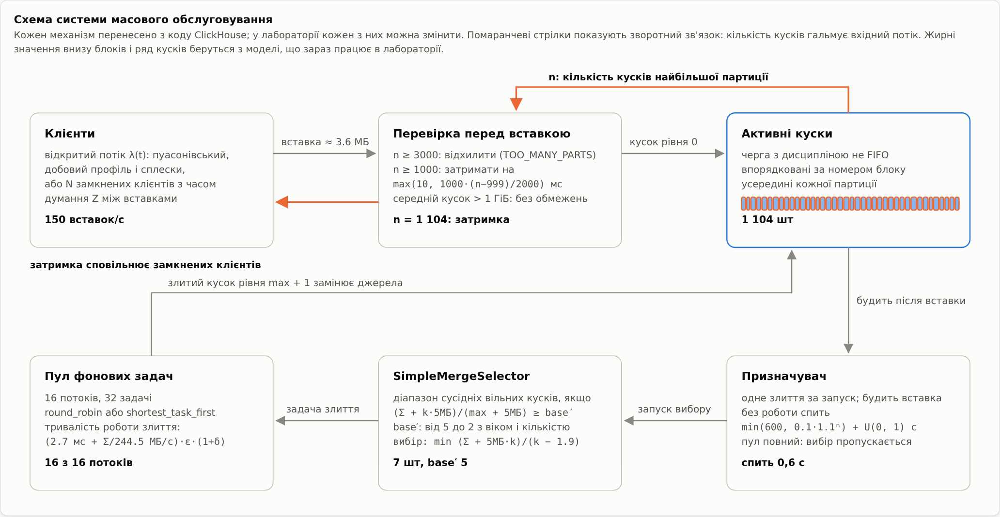

Стан моделі складається з рядів активних кусків кожної партиції (розмір, рівень, діапазон блоків, час створення, ознака «зливається»), задач у пулі з залишком роботи, стану призначувача і лічильників. Події такі:

| Подія | Що відбувається | Що планує |
|---|---|---|
| надходження вставки | перевірка порогів: відхилити, затримати або прийняти | фіксацію вставки, наступне надходження |
| фіксація вставки | новий кусок рівня 0, пробудження призначувача | запуск призначувача |
| запуск призначувача | вибір одного злиття, задача в пул | наступний запуск одразу або після сну |
| завершення задачі | заміна джерел злитим куском, перерозподіл потоків | наступне завершення |
| ротація партиції | нова партиція, видалення найстаріших | наступну ротацію |

Вхідний потік є нестаціонарним пуасонівським: інтенсивність може мати добовий профіль і короткі сплески, а генерується він методом проріджування. Крім відкритого потоку модель має замкнений: N клієнтів, кожен з яких після завершення своєї вставки думає випадковий час і вставляє знову. У замкненому варіанті затримка вставки прямо зменшує вхідний потік, і саме в ньому гальмування працює як справжній зворотний зв'язок.

Розмір вставки логнормальний із заданим середнім і коефіцієнтом варіації. Робота злиття дорівнює `(c0 + c1 · Σ) · ε · (1 + δ)`, де Σ сумарний розмір джерел, ε логнормальний шум із середнім 1, а δ надбавка за проєкції та індекси. Пул розподіляє потоки між задачами: у режимі `round_robin` кожна з n задач отримує частку min(1, 16/n) потоку, у режимі `shortest_task_first` потоки дістаються найменшим злиттям. Окремих кроків по 50 мс модель не відтворює: вони на порядки коротші за типове злиття, тож розподіл процесора є їхньою границею.

# Вхідні дані й калібрування

Параметри вартості злиття взято не з голови, а з журналу `system.part_log` окремого сервера ClickHouse 26.10, розгорнутого для роботи. На сервер подавались чотири навантаження: три по 10 хвилин (4 вставки за секунду по 25 тисяч рядків) у таблиці без допоміжних структур, з індексом `bloom_filter` і з проєкцією, а також п'ятихвилинне навантаження з дрібними вставками, без якого фіксована вартість злиття не визначається.

Для кожного злиття з журналу брались тривалість і сума розмірів джерел. Коефіцієнти c0 і c1 підбирались нелінійним методом найменших квадратів на логарифмічній шкалі, тобто для медіани, а потім перераховувались так, щоб шум мав середнє 1. Залишки регресії перевірялись на відсутність тренду з розміром і на форму розподілу.

| Параметр | Значення | Дані |
|---|---|---|
| фіксована вартість злиття c0 | 2.7 мс | 671 злиття від 1.26 МіБ до 2.3 ГіБ |
| швидкість злиття 1/c1 | 244.5 МБ/с на потік | те саме |
| коефіцієнт варіації шуму | 0.12 | те саме |
| залишки | кореляція Спірмена з розміром 0.02, асиметрія −0.13, ексцес −0.13 | логарифмічна шкала |
| середня вставка | 3.61 МБ, коефіцієнт варіації 0.35 | 25 тисяч рядків |
| індекс `bloom_filter` (надбавка до розміру s, до часу δ) | 0.007, 0.062 | 376 злиттів |
| проєкція (s, δ) | 0.99, 0.93 | 362 злиття |

Для проєкції лінійна модель вартості гірша: залишки ростуть з розміром злиття, тобто великі злиття з проєкцією непропорційно повільніші. Це записано як обмеження моделі.

Під час калібрування з'ясувалось, що з версії 26.2 у ClickHouse за замовчуванням увімкнені асинхронні вставки: сервер буферизує кілька вставок і пише їх одним куском. Модель описує звичайні вставки, тому генератор навантаження вимикає асинхронний режим явно.

# Програмна реалізація

Модель написана на Python без сторонніх залежностей у ядрі. Рушій тримає календар подій у бінарній купі, впорядкованій за часом і порядковим номером, тож події з однаковим часом виконуються в порядку планування. Кожне джерело випадковості має власний потік випадкових чисел: інтервали між вставками, розміри, шум тривалості злиття, сон призначувача, час думання кожного клієнта. Це потрібно для методу спільних випадкових чисел: якщо змінити, наприклад, швидкість злиття, потік вставок лишиться тим самим, і різниця між конфігураціями не тонутиме в шумі.

Модель не рахує статистику під час прогону, а записує факти: коли кожен кусок створено, коли його взяло злиття і коли він зник, коли кожна задача прийшла в пул і завершилась, яка затримка була у кожної вставки. Усі характеристики потім обчислюються з цих фактів для будь-якого вікна спостереження, без повторного прогону. Репліки виконуються паралельно на окремих процесах.

Селектор є найдорожчою частиною: на кожен виклик він перебирає до тисячі початків діапазону і до сотні довжин. Тому, крім прямого перенесення C++ коду, є векторизована версія на `numpy`, яка обробляє всі діапазони відрізка одночасно. Окремий тест перевіряє, що обидві версії обирають той самий діапазон на 3000 випадкових наборах кусків і дають однакові траєкторії цілих прогонів. Векторизація прискорила прогони біля межі стійкості з 400 до 75 секунд на 30 модельних хвилин.

Обсяг коду: близько 6 300 рядків, з них 2 200 рядків Python у моделі, статистиці, калібруванні й експериментах, 550 рядків тестів Python і близько 3 500 рядків інтерактивної лабораторії разом із її тестами.

# Верифікація

Верифікація відповідає на питання, чи модель робить те, що задумано. Перевірок кілька рівнів.

Інваріанти перевіряються після кожної події, на прогонах до мільйона подій: сума розмірів активних кусків дорівнює сумі прийнятих вставок мінус видалені партиції; куски кожної партиції не перетинаються за діапазонами блоків і покривають усі прийняті блоки; задач у пулі не більше за кількість місць, а зайнятих потоків не більше за кількість потоків; джерела кожного злиття стоять поруч; кожна вставка або прийнята, або чекає затримки, або відхилена.

Селектор перевірено на випадках з результатом, обчисленим вручну. Наприклад, п'ять свіжих кусків по 10 МіБ при `base = 5` є мінімумом для злиття, а чотири вже ні; старі куски знижують поріг до двох; кусок, що зливається, розриває ряд; дрібний кусок справа відкидається. На одному з таких випадків тест виявив, що ClickHouse обрізає дробову частину ліміту довжини діапазону, і на 60 кусках ліміт дорівнює 99, а не 100.

Граничні тести мають точну відповідь. Без злиттів один клієнт отримує рівно 3000 кусків і рівно 2000 затриманих вставок, а сумарна затримка дорівнює сумі формули гальмування. Для замкненого входу без гальмування пропускна здатність дорівнює N/Z, а з гальмуванням N/(Z + R), де R середня затримка, з похибкою до 5%. Для черги свіжих кусків виконується закон Літтла: середня кількість дорівнює добутку інтенсивності на середній час життя з відносною похибкою 0.3%.

Ще одна перевірка з'явилась разом із лабораторією. Ядро моделі переписано на JavaScript, і JavaScript-версія отримує ті самі випадкові числа, які витягла Python-модель. Обидві мусять дати ту саму трасу подій. Траси збігаються повністю на восьми конфігураціях, близько пів мільйона подій, включно з гальмуванням, відхиленнями, ротацією партицій і запізнілими вставками. Перший прогін цього тесту знайшов помилку перенесення в нормуванні порогу селектора, тож тест довів свою користь.

# Валідація

Валідація відповідає на інше питання: чи модель поводиться як справжня система. На тому самому сервері проганялись три навантаження, які не брали участі в калібруванні: відкритий потік 8 вставок за секунду, 8 замкнених клієнтів і відкритий потік 40 вставок за секунду зі зниженими порогами гальмування (15 і 45 кусків), щоб гальмування спрацьовувало часто. Кожне навантаження проганялось тричі по 6 хвилин на сервері і 20 разів у моделі. Розміри вставок модель брала з самого прогону, бо це вхідні дані, а вартість злиття лише з калібрування.

| Характеристика | відкритий, 8/с | 8 клієнтів | 40/с, низькі пороги |
|---|---|---|---|
| середня кількість кусків | +2.3% | +0.4% | +1.2% |
| зайняті потоки | −1.0% | −1.2% | +1.6% |
| очікування свіжого куска | −3.3% | −2.6% | −1.3% |
| час життя свіжого куска | −1.9% | +0.7% | −1.9% |
| тривалість злиття | +0.8% | +1.4% | +0.5% |
| підсилення записів | +8.4% | +7.4% | +5.7% |
| частка затриманих вставок | — | — | −13.4% (18.2% проти 21.1%) |
| середня затримка вставки | — | — | −29.5% (11.0 проти 15.6 мс) |

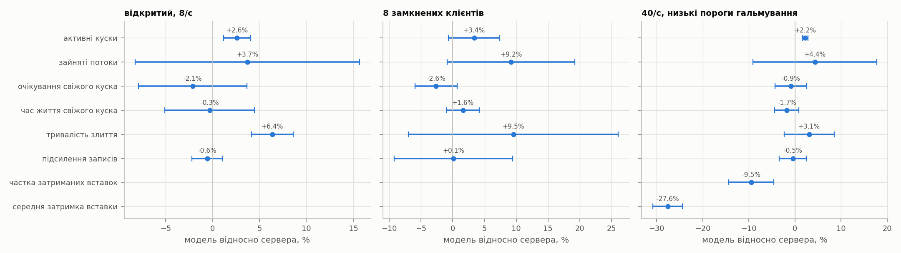

Середні характеристики збігаються в межах 3.3%. Формальний критерій «у межах довірчого інтервалу» виконується не завжди, але лише тому, що інтервали дуже вузькі, наприклад ±0.5% для кількості кусків. Систематичних розбіжностей дві. Підсилення записів у моделі на 6–8% вище, і лише 1–2% з цього пояснюються тим, що злитий кусок на диску трохи менший за суму джерел, а модель вважає його рівним. Характеристики гальмування, які залежать від хвоста розподілу кількості кусків, модель недооцінює: на сервері розподіл ширший, 99-й перцентиль 19.8 проти 18.2.

Дві гіпотези про причини перевірено вже без сервера, проти збережених прогонів. Затримка між пробудженням призначувача і вибором злиття розбіжностей не пояснює: навіть 10–30 мс помітно збільшують кількість кусків і час очікування, які й так збігались, а підсилення записів при цьому зростає. Хвіст розподілу кусків збігається, якщо коефіцієнт варіації тривалості злиття підняти з 0.12 до 1.5, але калібрування на злиттях того самого розміру такого розкиду не показало. Найімовірніше, причина в конкуренції за процесор під час валідаційного прогону, і перевірити це можна лише новим прогоном на сервері.

Тому висновки про середні значення модель дає надійно, а частку затриманих вставок біля порогу слід читати як нижню оцінку.

Під час валідації знайшлась і особливість самого ClickHouse. Запит `INSERT ... SELECT` будує кілька паралельних приймачів даних, за замовчуванням до 32 з обмеженням за вільною пам'яттю. Кожен приймач, навіть той, до якого не дійде жодного рядка, окремо перевіряє кількість кусків і окремо спить. Через це системні лічильники `DelayedInserts` і `DelayedInsertsMilliseconds` рахують не вставки, а приймачі, на сервері до 12 на одну вставку, а реальна додана затримка вставки під навантаженням виявилась утричі більшою за формулу. На чистому сервері цей ефект відтворено: одна вставка одного рядка з `max_insert_threads = 8` дає шість затримок по 500 мс у лічильниках. Для валідації затримку кожної вставки бралось з її власного запису в `system.query_log`.

# План експериментів

Усі експерименти беруть відкалібровану модель з налаштуваннями ClickHouse за замовчуванням і змінюють лише вказані фактори. Якщо не сказано інше, вставки мають 3.6 МБ, пул 16 потоків, вхід відкритий, 10 реплік по одній модельній годині, перші 10 хвилин відкидаються, довірчі інтервали 95% за розподілом Стьюдента.

Важливе спостереження щодо стаціонарності: загальна кількість кусків однієї партиції, що росте, не має стаціонарного режиму. Рівнів злиття стає більше з логарифмом розміру таблиці, а куски, що досягли межі 150 ГБ, більше не зливаються і накопичуються. Тому тривалість розігріву визначалась методом Велча не по загальній кількості кусків, а по кількості свіжих кусків рівня 0, яка стаціонарна. Ротація партицій (експеримент E10) робить стаціонарною і загальну кількість.

Межа стійкості шукалась бісекцією в логарифмічному масштабі: найбільша інтенсивність, за якої жодна з шести реплік не дала жодної затриманої вставки за 30 модельних хвилин. Прогін зупиняється на першій затриманій вставці, тож нестійкі точки дешеві, а всі дев'ять кривих просуваються разом, щоб один пул процесів обслуговував їх усі. Межа залежить від горизонту спостереження, бо біля неї кусків стає більше повільно, тому в результатах вона названа межею на горизонті 30 хвилин.

| № | Питання | Фактори |
|---|---|---|
| E1 | як характеристики залежать від навантаження | 25–300 вставок/с, 9 рівнів |
| E2 | що дає розмір пакета за однакового потоку даних | 180 МБ/с; вставки 0.29–14.4 МБ; пул 4 і 16 |
| E3 | де межа стійкості | розмір вставки × (пул 16, пул 4, пул 16 з проєкцією) |
| E4 | компроміс підсилення записів і кількості кусків | `SimpleMergeSelector` з base 2–20 проти tiered з base 2–12 |
| E5 | чи кращий `shortest_task_first` біля насичення | обидві політики при 200 і 250 вставках/с |
| E6 | як працює зворотний зв'язок | відкритий і замкнений вхід × обмеження за розміром куска |
| E7 | скільки триває відновлення після сплеску | сплеск ×1.5, ×2, ×3 на 5 хвилин |
| E8 | вартість допоміжних структур | без структур, індекс, проєкція, обидва |
| E9 | які фактори найвпливовіші | факторний план 2⁵ |
| E10 | що змінює ротація партицій | партиції по 10 хвилин, зберігаються 3 |

# Результати

## E1. Характеристики від навантаження

До 200 вставок за секунду кількість кусків росте майже лінійно, з 28 до 155, зайняті потоки ростуть пропорційно потоку даних, а підсилення записів тримається біля 5.1–5.4. Між 200 і 225 вставками пул насичується: імовірність того, що зайняті всі 16 потоків, стрибає з 0.69 до 1.0. Далі система сама зменшує підсилення записів, до 4.7 при 225 і 3.6 при 300 вставках за секунду: кусків стає більше, поріг селектора знижується, і злиття стають ширшими. Платою за це є кількість кусків, 910 у середньому при 300 вставках, і хвіст очікування свіжого куска, 99-й перцентиль якого зростає з 0.05 до 0.55 с.

Неочевидний результат: середній час очікування свіжого куска має мінімум біля 200 вставок за секунду. При малому навантаженні кусок чекає, поки поруч набереться достатньо інших для злиття, а при великому чекає вільного потоку.

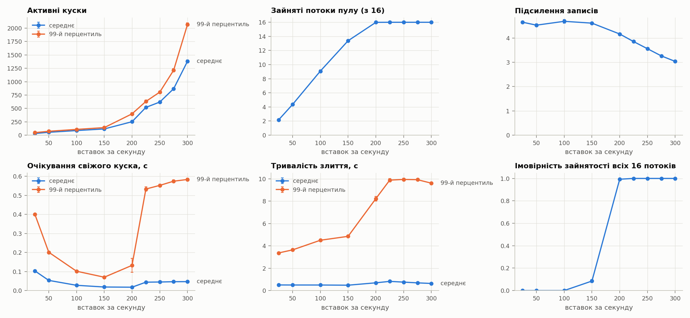

## E2. Розмір вставки за однакового потоку даних

При 180 МБ/с і пулі 16 дрібні вставки по 0.29 МБ дають 64 куски і підсилення записів 6.75, а великі по 14.4 МБ дають 44 куски і 4.46. Пул з 4 потоків при дрібних вставках насичується, і система переходить у режим «менше злиттів, більше кусків»: 235 кусків при підсиленні 5.0. Кількісно це та сама порада, яку ClickHouse дає користувачам: вставляйте рідше і більшими пакетами.

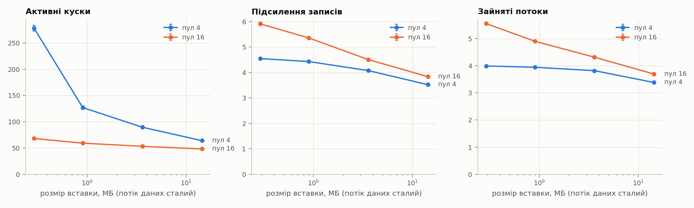

## E3. Межа стійкості

| Розмір вставки | пул 16 | пул 4 | пул 16 з проєкцією |
|---|---|---|---|
| 0.9 МБ | 1024 вставки/с (921 МБ/с) | 298 (268 МБ/с) | 581 (523 МБ/с) |
| 3.6 МБ | 317 (1142 МБ/с) | 91 (327 МБ/с) | 188 (677 МБ/с) |
| 14.4 МБ | 103 (1489 МБ/с) | 29 (424 МБ/с) | 64 (917 МБ/с) |

Межа в 1.2–2.3 раза вища за наївну оцінку «потоки × швидкість злиття / (5 × розмір вставки × (1 + δ))», бо біля межі підсилення записів падає до 2.2–4.3, тим нижче, чим більша вставка. Межа майже пропорційна розміру пулу: учетверо більший пул дає в 3.4–3.6 раза вищу межу. Проєкція зменшує межу на 38–43%.

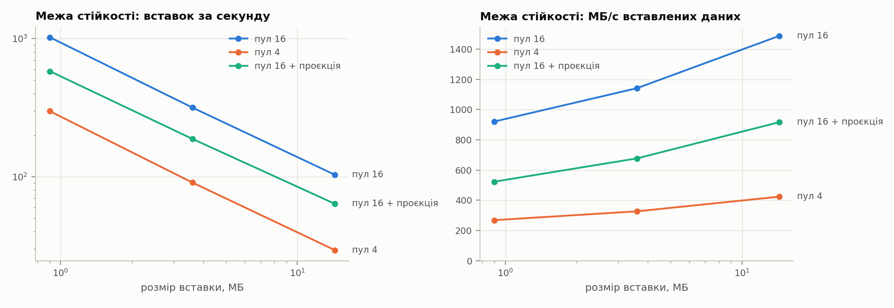

## E4. Компроміс селектора

Для `SimpleMergeSelector` зі зростанням `merge_selector_base` підсилення записів падає з 7.0 до 3.3, а кількість кусків має мінімум при base 3, 94 куски, а не при найменшому base. При base 2 злиттів так багато, що пул насичується, і кусків стає 165. Значення за замовчуванням base 5 дає 112 кусків при підсиленні 5.2. Базовий tiered-селектор при base 6–12 дає майже ту саму криву, але при base 2 і 3 деградує: при base 2 зайнято лише 0.4 потоку, кусків 3000, і вставки відхиляються. Тож перевага `SimpleMergeSelector` поблизу значень за замовчуванням не в ефективності, а в стійкості до малих base.

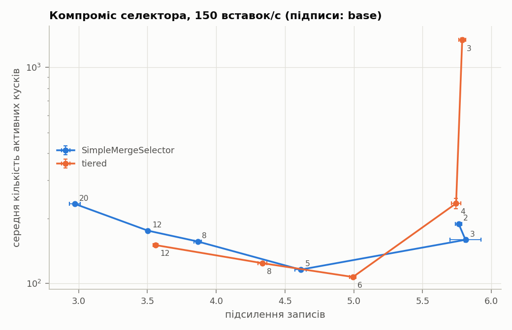

## E5. Планувальник пулу

Різниці між `shortest_task_first` і `round_robin` рахувались парно, на спільних випадкових числах. При 200 вставках за секунду `shortest_task_first` зменшує кількість кусків на 6% (−9.8 ± 2.8), при 250 вже на 28% (−135 ± 10), а 99-й перцентиль тривалості злиття майже вдвічі, з 8.7 до 4.8 с. На підсилення записів планувальник значуще не впливає. Біля насичення дрібні злиття сильніше зменшують кількість кусків на одиницю роботи, і пріоритет за розміром дає їм прохід першими.

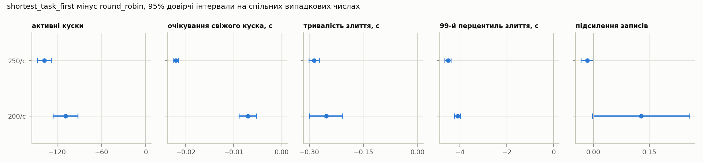

## E6. Гальмування як зворотний зв'язок

Пропонований потік 350 вставок за секунду, вище за межу стійкості.

| Вхід | Обмеження за розміром куска | Досягнутий потік | Кусків у середньому | Відхилено |
|---|---|---|---|---|
| відкритий | за замовчуванням | 350/с | 2322, до 4068 | 4.6% |
| замкнений | за замовчуванням | 347/с | 2177, до 4116 | 2.5% |
| відкритий | вимкнене | 350/с | 2153, до 3006 | 4.0% |
| замкнений | вимкнене | 284/с | 1045, до 1085 | 0% |

Без обмеження за середнім розміром куска замкнені клієнти самостабілізуються біля порогу гальмування: затримки зменшують їхній потік до пропускної здатності злиттів, 284 вставки за секунду, і жодна вставка не відхиляється. Відкритий вхід доходить до порогу відхилення і відхиляє 4% вставок. З обмеженням за замовчуванням зворотний зв'язок не працює для жодного входу. Середній кусок у партиції досягає 1 ГіБ на 15–22-й хвилині і далі коливається біля цієї межі: поки він більший, гальмування вимкнене, кусків стає більше, середній розмір падає, і захист вмикається знову. Кількість кусків при цьому росте далі, понад 4000.

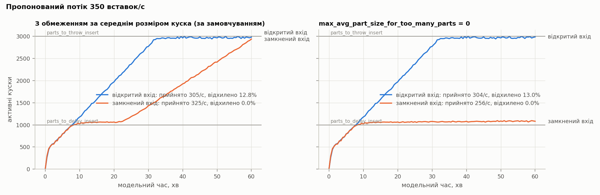

## E7. Відновлення після сплеску

Відновлення визначалось парно: перший момент після сплеску, коли кусків не більше ніж на 10% більше, ніж у прогоні з тими самими випадковими числами без сплеску.

| Множник сплеску | Пік кусків | Час відновлення |
|---|---|---|
| ×1.5 | 214 | 0.7 ± 0.3 хв |
| ×2 | 564 | 5.2 ± 0.5 хв |
| ×3 | 2146 | 18.1 ± 1.9 хв |

Час відновлення росте набагато швидше за множник. Сплеск утричі виводить систему за межу стійкості, і повернення займає втричі більше часу, ніж сам сплеск.

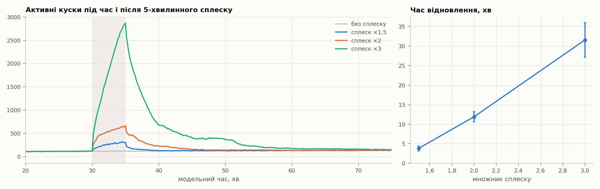

## E8. Допоміжні структури

| Варіант | Кусків | Зайняті потоки | Тривалість злиття |
|---|---|---|---|
| без структур | 86 | 7.6 | 0.42 с |
| індекс `bloom_filter` | 88 | 8.1 | 0.44 с |
| проєкція | 127 | 14.2 | 0.84 с |
| проєкція та індекс | 130 | 14.6 | 0.88 с |

Індекс практично нічого не коштує, а проєкція подвоює роботу пулу і при 100 вставках за секунду майже насичує його.

## E9. Факторний план 2⁵

Найсильніше на кількість кусків впливають проєкція (+37 кусків), base 3 → 8 (+18), розмір вставки 0.9 → 3.6 МБ (−13) і пул 8 → 16 (−10); планувальник дає лише −2. На підсилення записів найсильніше впливає base (−2.0), далі розмір вставки (−0.72) і проєкція (−0.68: насичений пул злиттів зменшує підсилення). Найбільші взаємодії: пул × base (+10) і пул × проєкція (−10), тобто з малим пулом і великий base, і проєкція шкодять сильніше.

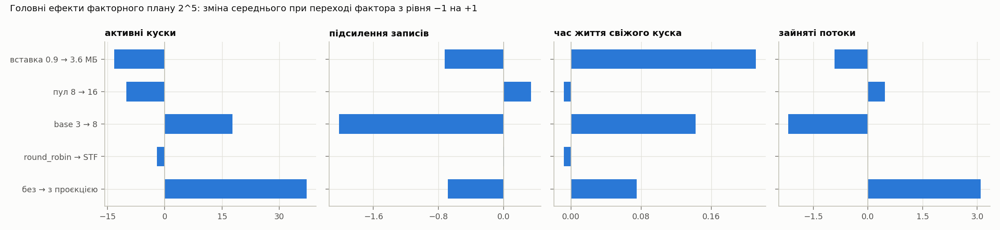

## E10. Ротація партицій

| Вхід | Варіант | Кусків у середньому | Підсилення записів | Відхилено |
|---|---|---|---|---|
| 150/с, 2 год | одна партиція | 126 (106 у першу годину, 137 у другу) | 5.58 | 0% |
| 150/с, 2 год | ротація | 115 (107 і 116) | 4.92 | 0% |
| 150/с, 2 год | ротація, 10% запізнілих вставок | 125 | 5.28 | 0% |
| 35 клієнтів, 1 год | одна партиція | 2177, до 4116 | 3.18 | 2.5% |
| 35 клієнтів, 1 год | ротація | 1612, пилкоподібно | 3.07 | 0% |

Ротація з видаленням старих партицій робить кількість кусків стаціонарною: після перших 30 хвилин крива стає пилкою, що падає щоразу, коли видаляється найстаріша партиція. Підсилення записів знижується на 12%, бо найглибші рівні злиття не встигають утворитися до видалення партиції, а запізнілі вставки повертають частину цієї ціни. Для замкнених клієнтів ротація дозволяє пропустити всі 350 вставок за секунду без відхилень, хоча для однієї партиції той самий потік вищий за межу стійкості: партиція видаляється раніше, ніж у ній накопичиться 1000 кусків.

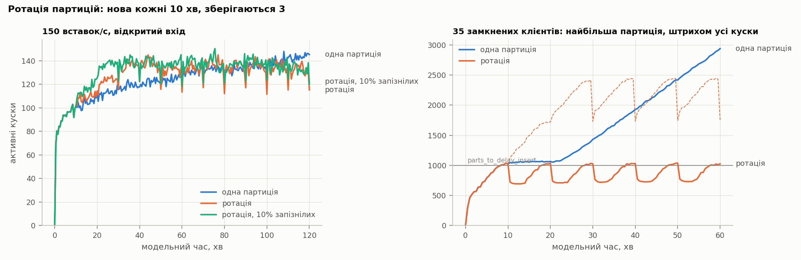

# Інтерактивна лабораторія

Щоб модель можна було не лише прочитати, а й побачити в роботі, зроблено лабораторію: одну веб-сторінку, яка відкривається з диска і працює без інтернету (`app/dist/index.html`). Модель виконується прямо в браузері, а не відтворює записані прогони, і, як описано у розділі про верифікацію, подія в подію збігається з Python-моделлю.

Час можна запускати, зупиняти і проходити по кроках до наступної події, а швидкість змінювати від ×0.25 до ×1000. Будь-який параметр змінюється на ходу: тип і інтенсивність входу, клієнти, розмір вставок, пул і планувальник, налаштування селектора, пороги гальмування, ротація партицій, вартість злиття, проєкція та індекс. Є й дії: сплеск вставок, зупинка вставок, нова партиція, видалення найстарішої партиції. Сторінка показує дерево кусків за рівнями злиття, пул з прогресом кожної задачі, показники за останню хвилину, живі графіки і журнал подій. Клік на кусок показує його розмір, вік і походження, клік на задачу виділяє її джерела, а окрема панель пояснює, чому селектор обрав саме цей діапазон: умову допуску з числами, знижений поріг, оцінку і кількість кандидатів. Дев'ять готових сценаріїв відтворюють головні результати експериментів.

# Висновки

Побудована дискретно-подієва модель відтворює підсистему фонових злиттів ClickHouse з точністю до правил вихідного коду, відкалібрована на живому сервері і на трьох незалежних навантаженнях збігається з ним за середніми характеристиками в межах 3.3%.

Підсистема має чітку межу стійкості, яка в 1.2–2.3 раза вища за наївну оцінку. Біля межі система сама жертвує кількістю кусків заради меншого підсилення записів, тому межа розмита, а не різка. Межа майже пропорційна розміру пулу, росте з розміром вставки і падає на 40% з проєкцією.

Гальмування вставок справді працює як зворотний зв'язок і для замкнених клієнтів стабілізує систему біля порогу без відхилень. Але обмеження за середнім розміром куска, яке в ClickHouse увімкнене за замовчуванням, вимикає цей захист у великій партиції, і кусків стає дедалі більше. Ротація партицій з видаленням старих це виправляє і заодно робить систему стаціонарною.

Біля насичення планувальник `shortest_task_first` помітно кращий за `round_robin`, значення `merge_selector_base` за замовчуванням близьке до оптимального, а мінімум кількості кусків досягається при base 3. Сплески вставок понад межу стійкості мають непропорційно довгі наслідки.

# Обмеження і подальша робота

Модель описує одну таблицю і звичайні синхронні вставки. Реплікація, мутації, TTL, запити на читання і обмеження вільного місця на диску не моделюються, як і асинхронні вставки, які з версії 26.2 увімкнені за замовчуванням і є природним наступним розширенням. Вартість злиття прив'язана до схеми таблиці, на якій проводилось калібрування. Лишаються відкритими причина вищого на 6–8% підсилення записів і ширшого хвоста розподілу кусків на сервері; для обох потрібні нові прогони на сервері з повним журналом `system.part_log`. Ротація партицій у експериментах іде в стиснутому часі, 10 модельних хвилин замість доби.

# Список джерел

1. Banks J., Carson J. S., Nelson B. L., Nicol D. M. Discrete-Event System Simulation. 5th ed. Pearson, 2010.
2. Law A. M. Simulation Modeling and Analysis. 5th ed. McGraw-Hill, 2015.
3. Fishman G. S. Discrete-Event Simulation: Modeling, Programming, and Analysis. Springer, 2001.
4. Zeigler B. P., Praehofer H., Kim T. G. Theory of Modeling and Simulation. 2nd ed. Academic Press, 2000.
5. Kelton W. D., Sadowski R. P., Sturrock D. T. Simulation with Arena. 6th ed. McGraw-Hill, 2014.
6. Ross S. M. Simulation. 5th ed. Academic Press, 2013.
7. Lewis P. A. W., Shedler G. S. Simulation of nonhomogeneous Poisson processes by thinning. Naval Research Logistics Quarterly, 26(3), 1979.
8. O'Neil P., Cheng E., Gawlick D., O'Neil E. The log-structured merge-tree (LSM-tree). Acta Informatica, 33(4), 1996.
9. Вихідний код ClickHouse, версія 26.10: https://github.com/ClickHouse/ClickHouse

# Додаток. Де що лежить і як запустити

Увесь проєкт є git-репозиторієм `merge-sim`. Модель і експерименти написані на Python у корені репозиторію, повний технічний опис у файлі `RFC.md`, результати експериментів у `results/`, дані валідації в `runs/`, лабораторія в `app/`.

Тести моделі запускаються командою `python3 -m pytest -q test_*.py`, експерименти командою `python3 run_experiments.py`, графіки командою `python3 plots.py`. Лабораторія відкривається з файлу `app/dist/index.html`, її тести запускаються в каталозі `app` командою `node --test tests/*.test.mjs`.
