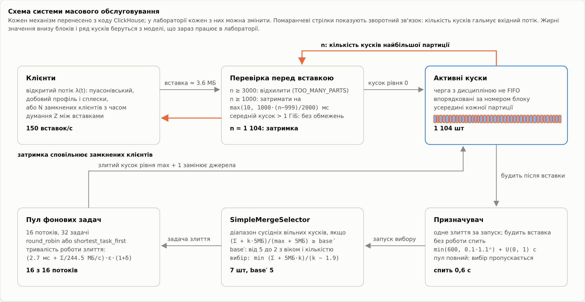
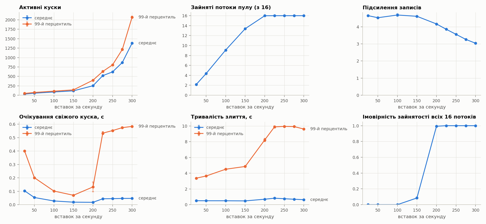
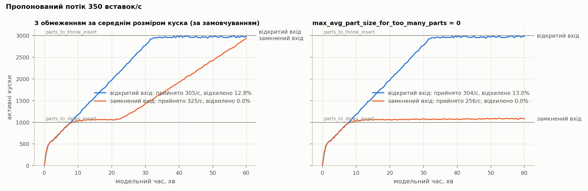
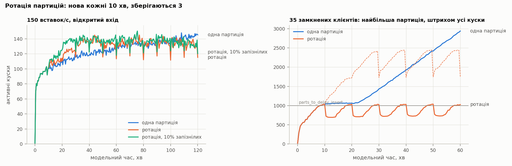
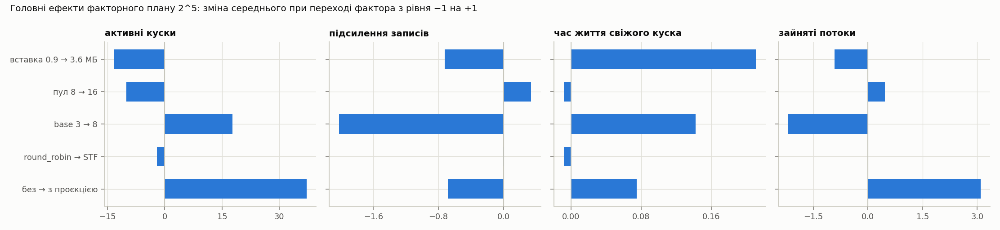
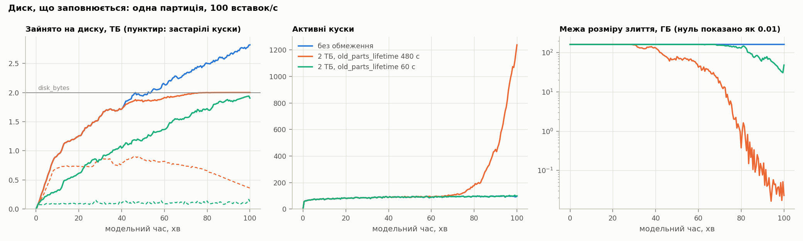
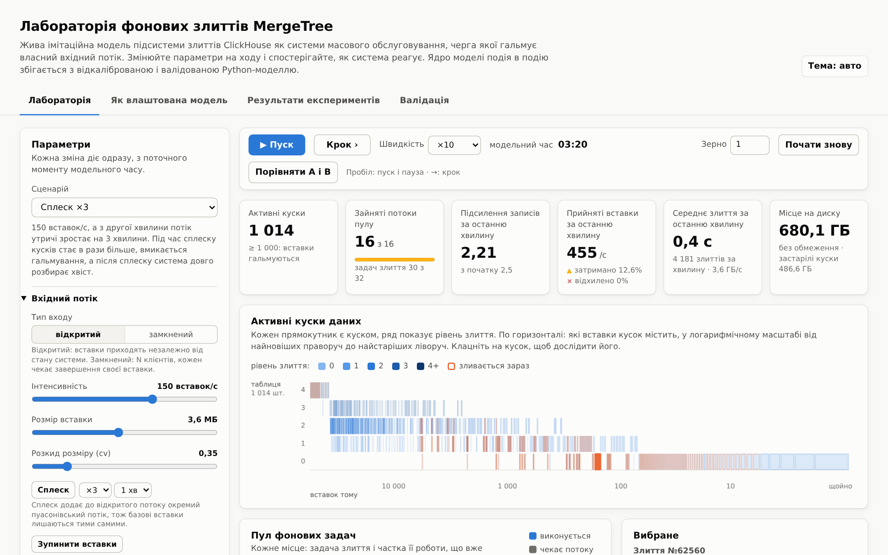

# Мета і постановка задачі

ClickHouse зберігає таблиці `MergeTree` як набір незмінних кусків даних. Кожна вставка записує на диск новий кусок, а фонові потоки зливають дрібні куски у більші. Якщо злиття не встигають, кусків стає дедалі більше, і сервер захищається: від 1000 кусків у партиції кожна вставка затримується до 1 с, а від 3000 відхиляється з помилкою `TOO_MANY_PARTS`. Отже, черга кусків сама гальмує свій вхідний потік.

Аналітично таку систему не розв'язати: обслуговування йде партіями змінного розміру, дисципліна вибору партії залежить від стану черги, а вхідний потік залежить від довжини черги. Тому побудовано дискретно-подієву імітаційну модель, яка відтворює правила з вихідного коду ClickHouse 26.10. Модель відкалібровано і валідовано на живому сервері, а потім використано для 11 експериментів.

Мета роботи: знайти межу стійкості підсистеми злиттів і пояснити, як від навантаження, розміру вставок, розміру пулу, налаштувань селектора, допоміжних структур, партиціювання і місця на диску залежать ймовірнісно-часові характеристики системи.

# Об'єкт і концептуальна модель

У термінах теорії масового обслуговування заявками є куски даних. Вони надходять із вставками і чекають у черзі, якою є впорядкований ряд активних кусків партиції. Приладами є 16 потоків фонового пулу, який має 32 місця для задач. Обслуговування партійне: селектор забирає з черги кілька сусідніх кусків, а результат повертається в ту саму чергу як кусок вищого рівня. Дисципліна обслуговування не FIFO і залежить від стану: від розмірів і віку кусків, довжини ряду і кількості вільних місць у пулі.

| Елемент ClickHouse | Елемент моделі |
|---|---|
| `INSERT` | заявка: відкритий нестаціонарний пуасонівський потік або N замкнених клієнтів з часом думання |
| кусок даних | елемент черги з рівнем злиття, розміром, віком і діапазоном блоків |
| `SimpleMergeSelector` | правило вибору партії: діапазон сусідніх вільних кусків, сума яких щонайменше в base′ разів більша за найбільший кусок |
| фоновий пул | 16 приладів, які діляться між задачами (`round_robin` або `shortest_task_first`) |
| призначувач злиттів | запуск після кожної вставки, без роботи сон 0.1·1.1ⁿ … 600 с |
| `delayInsertOrThrowIfNeeded` | зворотний зв'язок: затримка max(10, ⌊1000·(n − 999)/2000⌋) мс або відхилення |
| місце на диску, `DROP PARTITION` | резерв під злиття, застарілі куски, скасування злиттів при видаленні партиції |

{width=88%}

Модель має п'ять типів подій: надходження вставки (перевірка порогів), фіксація вставки (новий кусок рівня 0), запуск призначувача (вибір одного злиття), завершення задачі (злитий кусок замінює джерела) і ротація партиції. Розмір вставки логнормальний. Робота злиття дорівнює (c0 + c1·D)·(1 + δ)·ε, де D обсяг даних джерел, δ надбавка за проєкції та індекси, а ε логнормальний шум із середнім 1.

Модель рахує такі ймовірнісно-часові характеристики: кількість активних кусків (середнє за часом і квантилі), зайнятість пулу і ймовірність, що зайняті всі потоки, час очікування свіжого куска до злиття і його час життя, тривалість злиття, частки затриманих і відхилених вставок і час відновлення після сплеску. Окремо рахується підсилення записів: скільки байтів прочитали злиття на кожен вставлений байт, тобто скільки разів у середньому переписується кожен байт.

# Вхідні дані й калібрування

Параметри взято з журналу `system.part_log` окремого сервера ClickHouse 26.10. На сервер подавались чотири навантаження: таблиця без структур, з індексом `bloom_filter`, з проєкцією і окреме навантаження з дрібними вставками, без якого фіксована вартість злиття не визначається. Коефіцієнти c0 і c1 підбирались нелінійним методом найменших квадратів на логарифмічній шкалі.

| Параметр | Значення |
|---|---|
| фіксована вартість злиття c0 | 2.7 мс |
| швидкість злиття 1/c1 | 244.5 МБ/с на потік |
| коефіцієнт варіації шуму злиття | 0.12 |
| розмір злитого куска | 0.992 суми джерел; від 100 МіБ 0.795 для байтів, що ще не проходили таке злиття |
| сповільнення великих злиттів | 1.14 |
| кусок вставки | 3.61 МБ, коефіцієнт варіації 0.35 |
| надбавка до часу злиття: індекс, проєкція | δ = 0.10 і 1.00 |

Головна знахідка калібрування: злиття від приблизно 100 МіБ стискають дані вдруге і йдуть повільніше. Механізму цього в коді ClickHouse не знайдено, тож модель відтворює його як емпіричне правило. Інтервали між вставками узгоджуються з експоненційним законом (критерій Колмогорова-Смирнова з p-значеннями методом Монте-Карло: D = 0.013, p = 0.51). Шум тривалості злиття логнормальний лише наближено: середнє і розкид він передає, а форму хвоста ні.

# Програмна реалізація і верифікація

Модель написана на Python. Календар подій зберігається в бінарній купі за часом і порядковим номером. Кожне джерело випадковості має окремий генератор (вихор Мерсенна), тож дві конфігурації можна порівнювати методом спільних випадкових чисел. Модель не рахує статистику під час прогону, а записує факти: коли кожен кусок створено, взято в злиття і поглинуто. Характеристики потім обчислюються з фактів для будь-якого вікна спостереження. Репліки виконуються паралельно, а найдорожча частина, селектор, має векторизовану версію на `numpy`, яка прискорила прогони біля межі стійкості з 400 до 75 секунд.

Верифікація має кілька рівнів:

- інваріанти перевіряються після кожної події: баланс байтів, неперетинні діапазони блоків, обмеження пулу і диска;
- граничні тести з точною відповіддю: без злиттів один клієнт отримує рівно 3000 кусків і 2000 затриманих вставок;
- закон Літтла для черги свіжих кусків виконується в усіх експериментах з похибкою не більше 2.6%;
- селектор перевірено на випадках з результатом, обчисленим вручну, а векторизований селектор збігається з прямим на 3000 випадкових наборах;
- JavaScript-версія моделі для лабораторії отримує ті самі випадкові числа і дає ту саму трасу подій, що й Python-версія, на 15 конфігураціях (близько 860 тисяч подій).

Разом є 65 тестів моделі на Python і 21 тест лабораторії.

# Валідація

На тому самому сервері проганялись три навантаження, які не брали участі в калібруванні: відкритий потік 8 вставок/с, 8 замкнених клієнтів і 40 вставок/с зі зниженими порогами гальмування (15 і 45 кусків). Кожне навантаження проганялось тричі по 6 хвилин на сервері і 20 разів у моделі. Таблиця показує відхилення моделі від сервера.

| Характеристика | відкритий, 8/с | 8 клієнтів | 40/с, низькі пороги |
|---|---|---|---|
| середня кількість кусків | +2.6% | +3.4% | +2.2% |
| зайняті потоки | +3.7% | +9.2% | +4.4% |
| очікування свіжого куска | −2.1% | −2.6% | −0.9% |
| час життя свіжого куска | −0.3% | +1.6% | −1.7% |
| тривалість злиття | +6.4% | +9.5% | +3.1% |
| підсилення записів | −0.6% | +0.1% | −0.5% |
| частка затриманих вставок | — | — | −9.5% |
| середня затримка вставки | — | — | −27.6% |

Критерій валідації визначили заздалегідь: середнє моделі має лежати в 95% довірчому інтервалі сервера. Він виконується для 17 з 23 порівнянь, а підсилення записів збігається в межах 1%. Частина відхилень пояснюється вузькими інтервалами сервера, бо прогонів там лише три. Справжня розбіжність одна: гальмування. Частку затриманих вставок модель занижує на 9.5%, тож біля порогу її слід читати як нижню оцінку. Ймовірних причин дві: сервер і модель трохи по-різному рахують затримані вставки, а під час прогону сервер конкурував за процесор з іншими процесами машини.

# План експериментів

Усі експерименти беруть відкалібровану модель із налаштуваннями ClickHouse за замовчуванням. Якщо не сказано інше, куски вставок мають 3.6 МБ, пул 16 потоків, вхід відкритий, 10 незалежних реплік по одній модельній годині, довірчі інтервали 95% за розподілом Стьюдента. Кінець розігріву оцінювався методом Велча за кількістю свіжих кусків. Рядки однієї таблиці порівнюються між собою, тому мають спільний розігрів: найкоротший з 10, 20, 30 і 40 хвилин, що покриває оцінки всіх конфігурацій.

| № | Питання | Фактори |
|---|---|---|
| E1 | як характеристики залежать від навантаження | 25–300 вставок/с, 9 рівнів |
| E2 | що дає розмір пакета за однакового потоку даних | 180 МБ/с, вставки 0.29–14.4 МБ, пул 4 і 16 |
| E3 | де межа стійкості | розмір вставки × (пул 16, пул 4, пул 16 з проєкцією) |
| E4 | компроміс підсилення записів і кількості кусків | `SimpleMergeSelector` з base 2–20 проти tiered з base 2–12 |
| E5 | чи кращий `shortest_task_first` біля насичення | обидві політики при 200 і 250 вставках/с |
| E6 | як працює зворотний зв'язок | відкритий і замкнений вхід × обмеження за розміром куска |
| E7 | скільки триває відновлення після сплеску | сплеск ×1.5, ×2, ×3 на 5 хвилин |
| E8 | вартість допоміжних структур | без структур, індекс, проєкція, обидва |
| E9 | які фактори найвпливовіші | факторний план 2⁵, 6 реплік по 60 хвилин |
| E10 | що змінює ротація партицій | партиції по 10 хвилин, зберігаються 3 |
| E11 | що відбувається, коли диск заповнюється | 2 ТБ, `old_parts_lifetime` 480 і 60 с |

# Результати

## Навантаження і межа стійкості (E1, E3)

До 150 вставок/с кількість кусків росте майже лінійно, з 31 до 121, а зайняті потоки ростуть пропорційно потоку даних. Між 150 і 200 вставками/с пул насичується: імовірність того, що зайняті всі 16 потоків, стрибає з 0.12 до 1.00. Далі система сама зменшує підсилення записів, з 4.8 до 3.0 при 300 вставках/с: кусків стає більше, поріг селектора знижується, і злиття стають ширшими. Платою за це є кількість кусків і хвіст очікування свіжого куска (p99 у таблиці є 99-м перцентилем).

| Вставок/с | 25 | 100 | 150 | 200 | 250 | 300 |
|---|---|---|---|---|---|---|
| кусків | 31.4 ± 0.2 | 88.8 ± 1.6 | 121.3 ± 0.7 | 291 ± 13 | 679 ± 8 | 1659 ± 25 |
| зайняті потоки | 2.18 | 9.30 | 13.7 | 16.0 | 16.0 | 16.0 |
| підсилення | 4.64 | 4.83 | 4.80 | 4.15 | 3.55 | 3.04 |
| очікування, p99, с | 0.40 | 0.10 | 0.07 | 0.19 | 0.55 | 0.59 |

{width=88%}

Неочевидний результат: середній час очікування свіжого куска мінімальний біля 150–200 вставок/с. При малому навантаженні кусок чекає, поки поруч набереться достатньо інших для злиття, а при великому чекає вільного потоку.

Межу стійкості шукали бісекцією: найбільша інтенсивність, за якої за 30 хвилин жодна з 6 реплік не дійшла до 1000 кусків.

| Розмір вставки | пул 16 | пул 4 | пул 16 з проєкцією |
|---|---|---|---|
| 0.9 МБ | 906–934 вставки/с | 281–289 | 496–511 |
| 3.6 МБ | 281–289 | 87–91 | 149–154 |
| 14.4 МБ | 82–84 | 27–28 | 45–47 |

Межа майже пропорційна розміру пулу: учетверо більший пул дає в 3.0–3.2 раза вищу межу. Проєкція зменшує межу на 45–47%. У мегабайтах за секунду межа росте з розміром вставки: 815 МБ/с для вставок по 0.9 МБ і 1177 МБ/с для 14.4 МБ при пулі 16. Більші вставки дають менше підсилення записів, тож той самий пул переробляє більше даних.

## Гальмування як зворотний зв'язок (E6, E10)

Пропонований потік 350 вставок/с вищий за межу стійкості. Вхід порівнювали відкритий і замкнений (35 клієнтів), з обмеженням за середнім розміром куска і без нього.

| Вхід | Обмеження за розміром куска | Прийнято | Кусків у середньому | Затримано | Відхилено |
|---|---|---|---|---|---|
| відкритий | за замовчуванням | 294/с | 2817 | 84% | 16.0% |
| замкнений | за замовчуванням | 320/с | 1933, росте до 2940 | 8.0% | 0% |
| відкритий | вимкнене | 293/с | 2817 | 84% | 16.3% |
| замкнений | вимкнене | 256/с | 1074 | 100% | 0% |

{width=90%}

Гальмування працює як зворотний зв'язок лише для замкнених клієнтів: затримки зменшують їхній потік до пропускної здатності злиттів, 256 вставок/с, і система стабілізується біля порогу без жодного відхилення. Відкритий вхід від затримок не сповільнюється, близько 33-ї хвилини доходить до порогу відхилення і відхиляє 16% вставок.

Обмеження за середнім розміром куска, увімкнене в ClickHouse за замовчуванням, вимикає цей захист. Між 20-ю і 25-ю хвилиною середній кусок у партиції досягає 1 ГіБ, гальмування вимикається, і кусків стає дедалі більше, до 2940 на кінець години. Тобто обмеження вимикає захист саме там, де він працював би.

Ротація партицій (E10) повертає зворотний зв'язок: партиції лишаються малими, і гальмування весь прогін тримає найбільшу партицію біля порогу, 690–1040 кусків. Прийнято 341 вставку/с проти 311 з однією партицією, бо дорогих злиттів старих партицій не відбувається. Для відкритого входу ротація робить кількість кусків стаціонарною і зменшує підсилення записів на 14%, але кусків стає на 3% більше. Причина в тому, що кожна команда `DROP PARTITION` скасовує всі злиття таблиці, у середньому 13 за раз, і їхня робота втрачається.

{width=90%}

## Фактори та їх взаємодії (E9)

Факторний план 2⁵ варіює розмір вставки, розмір пулу, `merge_selector_base`, планувальник і проєкцію при потоці даних 180 МБ/с. Ефекти рахувались для кожної з 6 реплік окремо, бо кожна є повним повторенням плану на спільних випадкових числах.

На кількість кусків найсильніше впливає проєкція (+67.5 ± 0.5), далі пул 8 → 16 (−37.1 ± 1.1) і розмір вставки 0.9 → 3.6 МБ (−27.1 ± 1.2). На підсилення записів найсильніше впливає base 3 → 8 (−1.52 ± 0.03). Найбільші взаємодії: пул × проєкція (−37.2 ± 1.1) і пул × base (+30.5 ± 1.4). Наприклад, base 3 → 8 віднімає 30 кусків з пулом 8 і додає 31 з пулом 16, тому його головний ефект на кількість кусків близький до нуля. Тобто окремий фактор без взаємодій тут оцінювати не можна.

## Інші експерименти (E2, E4, E5, E7, E8, E11)

- **Розмір вставки (E2).** За однакового потоку 180 МБ/с дрібні вставки по 0.29 МБ дають 69 кусків і підсилення записів 6.0, а великі по 14.4 МБ дають 48 кусків і 3.8. Це кількісне підтвердження поради ClickHouse вставляти рідше і більшими пакетами.
- **Селектор (E4).** Кількість кусків мінімальна саме при base 5 за замовчуванням: 123 куски. Простий tiered-селектор при base 2 зупиняється зовсім, і кусків стає 3000. Перевага `SimpleMergeSelector` полягає у стійкості до малих base, а не в ефективності.
- **Планувальник (E5).** Біля насичення `shortest_task_first` дає на 21–30% менше кусків, ніж `round_robin`, і приблизно вдвічі коротший 99-й перцентиль тривалості злиття.
- **Сплеск (E7).** Час відновлення росте набагато швидше за множник сплеску: 3.8 ± 0.7 хв для ×1.5, 11.9 ± 1.3 хв для ×2 і 31.6 ± 4.4 хв для ×3. Сплеск утричі на 5 хвилин розбирається пів години.
- **Допоміжні структури (E8).** Індекс `bloom_filter` майже нічого не коштує (+6% кусків), а проєкція вже при 100 вставках/с насичує пул і подвоює кількість кусків.
- **Диск (E11).** Злиття стартує, лише якщо вільно вдвічі більше за його джерела, а злиті джерела ще 8 хвилин займають диск, до 45% зайнятого місця. Тому на 2 ТБ великі злиття перестають стартувати вже на 34-й хвилині, задовго до першої відмови `NOT_ENOUGH_SPACE` на 74-й. Після заповнення диска кусків стає дедалі більше: 1238 на 100-й хвилині.

{width=90%}

# Інтерактивна лабораторія

Щоб модель можна було побачити в роботі, зроблено лабораторію: одну веб-сторінку, яка працює без інтернету. Модель виконується прямо в браузері, і, як показує тест трас, подія в подію збігається з Python-моделлю. Будь-який параметр змінюється на ходу. Сторінка показує дерево кусків за рівнями злиття, пул з прогресом задач, живі графіки, журнал подій і пояснення кожного рішення селектора. Режим «Порівняти A і B» запускає поруч дві конфігурації на спільних випадкових числах.

{width=54%}

# Висновки

1. Побудована дискретно-подієва модель відтворює підсистему фонових злиттів ClickHouse з точністю до правил вихідного коду. На трьох незалежних навантаженнях вона потрапляє в 95% інтервал сервера для 17 з 23 порівнянь, а підсилення записів збігається в межах 1%. Частку затриманих вставок біля порогу модель занижує на 9.5%.
2. Найбільше результати змінила емпірична величина, а не правило з коду: злиття від приблизно 100 МіБ стискають дані і йдуть повільніше. Без цього правила модель завищувала підсилення записів на 6–8%, а межі стійкості на 4–40%.
3. Для вставок по 3.6 МБ і пулу 16 потоків пул насичується між 150 і 200 вставками/с. Далі система сама жертвує кількістю кусків заради меншого підсилення записів, тому межа на горизонті 30 хвилин лежить вище, біля 285 вставок/с. Межа майже пропорційна розміру пулу і падає на 45–47% з проєкцією.
4. Гальмування працює як зворотний зв'язок лише для клієнтів, які чекають своєї вставки. Обмеження за середнім розміром куска, увімкнене за замовчуванням, вимикає цей захист у великій партиції вже за 20–25 хвилин. Ротація партицій його повертає, але кожен `DROP PARTITION` скасовує всі злиття таблиці.
5. Місце на диску треба планувати із запасом: до обсягу даних додаються злиті джерела, що чекають видалення, і подвійний розмір найбільшого злиття.
6. Біля насичення `shortest_task_first` кращий за `round_robin`, а значення `merge_selector_base` за замовчуванням дає найменше кусків. Сплески понад межу стійкості мають непропорційно довгі наслідки.

Обмеження моделі: одна таблиця, лише синхронні вставки, без реплікації, мутацій і запитів на читання. Калібрування прив'язане до однієї схеми таблиці.

# Джерела

1. Law A. M. Simulation Modeling and Analysis. 5th ed. McGraw-Hill, 2015.
2. Banks J., Carson J. S., Nelson B. L., Nicol D. M. Discrete-Event System Simulation. 5th ed. Pearson, 2010.
3. Lewis P. A. W., Shedler G. S. Simulation of nonhomogeneous Poisson processes by thinning. Naval Research Logistics Quarterly, 26(3), 1979.
4. O'Neil P., Cheng E., Gawlick D., O'Neil E. The log-structured merge-tree (LSM-tree). Acta Informatica, 33(4), 1996.
5. Вихідний код ClickHouse, версія 26.10: https://github.com/ClickHouse/ClickHouse
